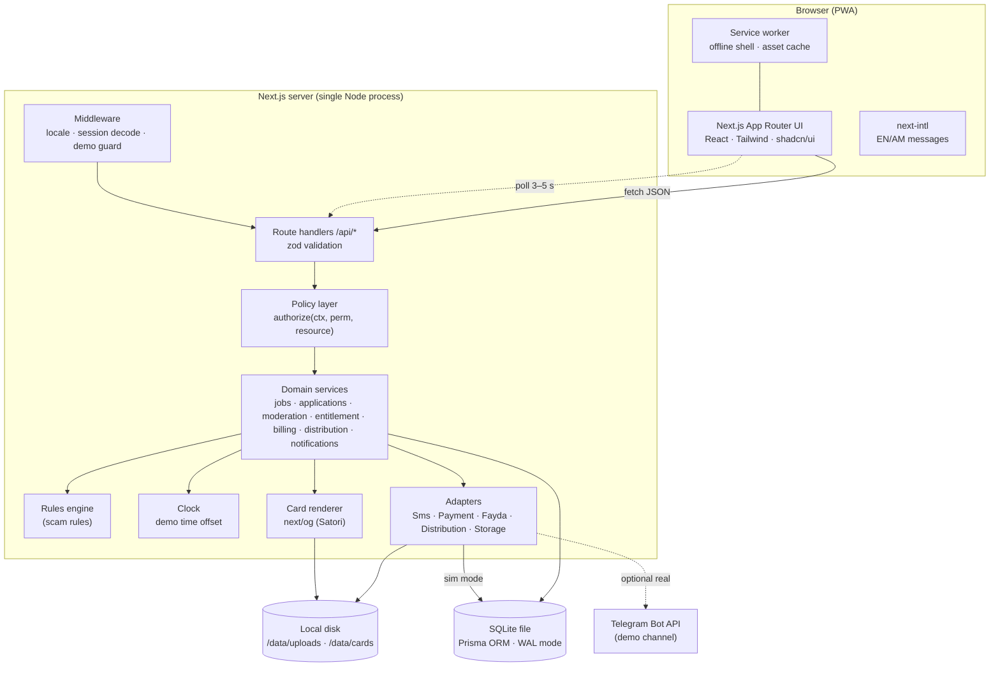

# Servaddis Demo — Technical Requirements Document (TRD)

| | |
|---|---|
| **Document** | 02 of 6 — Demo Specification Pack |
| **Version** | 0.1 (draft for review) · 29 Oct 2026 |
| **Depends on** | 01 PRD · 03 App Flow · 05 Backend Schema |
| **Used by** | 06 Implementation Plan |
| **Decision (confirmed)** | **Next.js full-stack + SQLite**, simulated integrations behind adapters, light backend |

---

## 1. Purpose and technical goals

Build a **single deployable web application** that implements the Servaddis hiring loop end to end for demonstration, with real persistence, real authorization and real bilingual content, while **simulating** everything that needs third-party onboarding (SMS, payments, Fayda, social platforms).

| # | Goal | Consequence |
|---|---|---|
| T1 | Light backend | One codebase, one process, one database file, no queue/Redis/containers beyond a single image |
| T2 | Real where it matters to the story | RBAC, moderation workflow, entitlement, pipeline, card render are real code paths |
| T3 | Deterministic demos | Seed + reset + demo clock + "simulate applicant" make every run reproducible |
| T4 | Looks production-grade | Same stack family as the proposal's front-end (Next.js, Tailwind, shadcn/ui, PWA) |
| T5 | Survives a bad venue network | Runs locally with one command; hosted copy is a convenience, not a dependency |
| T6 | Disposable by design | Carry forward schema, taxonomy, copy and UI components; do not carry the back-end stack (§17) |

## 2. Architecture overview



**Key properties**

- **Route handlers are thin.** Parse and validate input with `zod`, resolve the actor, call a domain service, shape the response.
- **Authorization is a pure function** in the policy layer, used by every handler and by the UI (via `/api/me`) to hide controls. The UI never *decides* access.
- **Adapters** isolate everything non-core. Each has a `sim` implementation (default) and an interface that a real provider can implement later. Simulated adapters write to the database (`SmsLog`, `DistributionPost`, `Payment`) so the presenter can show what *would* have happened.
- **No background workers.** Time-based work (expiry, reminders, check-ins) runs in a **sweep** function triggered (a) on a 60-second interval inside the server, (b) after any time-skip, (c) lazily on read of affected resources.

## 3. Technology stack

| Concern | Choice | Why / note | Production counterpart (proposal) |
|---|---|---|---|
| Runtime | Node.js 22 LTS or newer; pnpm | Stable, matches local tooling | Node (bot), PHP 8.3 (API) |
| Framework | **Next.js** (current stable, App Router) + TypeScript (strict) | One codebase for UI and API; PWA-capable | Next.js (PWA) |
| UI | Tailwind CSS, **shadcn/ui** (Radix), lucide icons | Matches proposal stack; accessible primitives | Same |
| State/data fetching | **SWR** (polling via `refreshInterval`) | Tiny; built-in revalidation and dedupe | Same or TanStack Query |
| Forms/validation | React Hook Form + **zod** (shared schemas client/server) | One validation source | — |
| i18n | **next-intl**; messages in `messages/en.json`, `messages/am.json` | App Router support, ICU plurals | Same |
| Database | **SQLite** (WAL), **Prisma 6.x** | Zero ops; schema is the reference model | MySQL 8 |
| Auth | Own minimal session: OTP → **signed httpOnly cookie** (JWT via `jose`) | No external provider; ~150 LOC | Laravel auth + OTP |
| Rate limiting | In-memory token bucket (per phone/IP) | Single instance | Redis |
| Charts | Recharts (code-split to Insights route only) | Quick; excluded from jobseeker bundles | — |
| Card render | `next/og` (Satori + resvg) rendering JSX to PNG | Real image output, no headless browser | FFmpeg/Remotion or templating API |
| QR codes | `qrcode` (server-side to data URL) | Deep link on card | — |
| PWA | **Serwist** (service worker) + web manifest | Maintained successor to next-pwa | Same |
| Uploads | Native `FormData`; magic-byte check; stored on disk | No cloud dependency | Object storage |
| Testing | Vitest (unit), Playwright (e2e + mobile emulation + throttling) | Scripted demo run = e2e test | — |
| Lint/format | ESLint, Prettier, `tsc --noEmit` | — | — |
| CI | GitHub Actions: lint → typecheck → unit → e2e | Demo script must pass before any external showing | — |
| Packaging | Single `Dockerfile`; `pnpm demo` for local | See §14 | CI/CD to VPS |
| Logging | `pino` JSON to stdout | | — |

> **Prisma 7 note:** if you choose Prisma 7, `datasource.url` is no longer allowed in `schema.prisma`; configure the connection in `prisma.config.ts` and pass a driver adapter (e.g. better-sqlite3) to `PrismaClient`. Everything else in this TRD is unchanged. Pin the exact versions of Next.js, Prisma and Tailwind in `package.json` on day 1.

## 4. Repository layout

```
servaddis-demo/
├─ prisma/
│  ├─ schema.prisma                  # doc 05 §4
│  ├─ seed/
│  │  ├─ index.ts                    # orchestrates seed
│  │  ├─ taxonomy.ts                 # cities, sub-cities, skills, role templates
│  │  ├─ plans.ts
│  │  ├─ people.ts                   # personas, jobseeker roster
│  │  ├─ jobs.ts                     # live feed jobs
│  │  └─ history.ts                  # deterministic seeded PRNG for insights
├─ messages/{en.json,am.json}
├─ public/{icons/,fonts/,manifest.webmanifest,samples/license-sample.pdf}
├─ src/
│  ├─ app/
│  │  ├─ (public)/{page.tsx,login/,jobs/,jobs/[id]/}
│  │  ├─ (jobseeker)/me/{applications/,profile/}
│  │  ├─ (employer)/employer/{page.tsx,onboarding/,jobs/,team/,insights/,plans/,payments/,venue/}
│  │  ├─ (admin)/admin/{queue/,audit/}
│  │  ├─ sim/chapa/[paymentId]/page.tsx
│  │  └─ api/…                       # route handlers (§7)
│  ├─ server/
│  │  ├─ db.ts                       # Prisma client (WAL pragma on connect)
│  │  ├─ clock.ts                    # now(), offset, sweep()
│  │  ├─ session.ts                  # sign/verify cookie
│  │  ├─ policy/{permissions.ts,presets.ts,authorize.ts}
│  │  ├─ services/{auth,venues,jobs,applications,moderation,entitlement,billing,distribution,notifications,insights,team}.ts
│  │  ├─ rules/{engine.ts,rules.json,blocked_keywords.txt}
│  │  ├─ adapters/{sms,payment,fayda,distribution,storage}/{index.ts,sim.ts,(real).ts}
│  │  └─ demo/{reset.ts,persona.ts,simulate.ts,timeskip.ts}
│  ├─ components/{ui/,employer/,jobseeker/,admin/,demo/}
│  ├─ lib/{i18n.ts,format.ts,api.ts,zod-schemas.ts}
│  └─ styles/tokens.css              # doc 04 tokens
├─ tests/{unit/,e2e/demo-script.spec.ts}
├─ Dockerfile · .env.example · README.md
```

## 5. Core modules

### 5.1 Session and authentication

- `POST /api/auth/otp/request` creates an `Otp` row (6-digit code, **HMAC-SHA-256** hash with server secret, 5-minute expiry), writes an `SmsLog` entry via the Sms adapter, and returns `{ resendInSec: 30 }`.
- In `DEMO_MODE`, the code is always `123456` (the row and lockout still apply, so rate-limit behaviour is demoable).
- `POST /api/auth/otp/verify` checks hash, expiry and attempts (max 5; then 10-minute lock), consumes the OTP, upserts the `User`, and sets the cookie `sv_session` = JWT `{ sub, role, iat, exp }` (HS256, 12 h) with `HttpOnly; Secure; SameSite=Lax; Path=/`. *`Secure` is set only when the request is HTTPS (directly or via `X-Forwarded-Proto: https` from the Cloudflare tunnel). The phone reaches the local demo over plain http on the LAN (D-9), where browsers would drop a Secure cookie (decision log, 30 Oct 2026).*
- Mutating requests require a same-origin `Origin`/`Referer` (CSRF mitigation with SameSite=Lax).
- Persona switch (`/api/demo/persona`) issues a normal session for the chosen seeded user; it is disabled when `DEMO_MODE` is off.

### 5.2 Authorization (policy layer)

```ts
// server/policy/authorize.ts  (shape, not final code)
type Ctx = { userId: string; platformRole: 'EMPLOYER'|'JOBSEEKER'|'ADMIN' };

export async function authorizeVenue(ctx: Ctx, venueId: string, perm: PermissionKey) {
  const m = await db.venueMember.findFirst({ where: { venueId, userId: ctx.userId, status: 'ACTIVE' } });
  if (!m) throw new NotFound();                       // no leak
  const eff = effective(m);                           // PRESETS[m.role] ∪ grant − revoke
  if (!eff.has(perm)) throw new Forbidden(perm);      // 403
  return { member: m, permissions: eff };
}

export async function authorizeJob(ctx: Ctx, jobId: string, perm: PermissionKey) {
  const job = await db.job.findUnique({ where: { id: jobId }, select: { venueId: true, status: true } });
  if (!job) throw new NotFound();
  return { job, ...(await authorizeVenue(ctx, job.venueId, perm)) };   // venue always derived from the resource
}
```

- Wrapper `withAuth({ perm, resource })` turns this into a one-liner per route.
- `GET /api/me` returns `{ user, memberships: [{ venueId, role, permissions[] }], unreadCount, locale }`. The UI uses `permissions[]` to hide/disable controls. **Hiding is cosmetic; the API enforces.**
- A unit-test matrix asserts every endpoint × role preset × grant/revoke combination against the table in doc 03 §6.1.

### 5.3 Jobs, moderation and the rules engine

- `jobs.submit(jobId, actor)` runs, in order: permission → venue `VERIFIED` → required fields → **rules engine** → entitlement → persist (`PENDING_REVIEW`, `ModerationItem`) in one transaction.
- The rules engine is a pure function: `run(job, template) → Flag[]` with `{ ruleId, severity: 'block'|'warn'|'info', messageEn, messageAm, field }`. Any `block` flag aborts the submit with **422** and the flag list. Rules and messages: doc 05 §7.1.
- `POST /api/jobs/:id/check` runs the same function without side effects so the composer can show flags live (debounced).
- Admin decisions are transactional: update `ModerationItem`, transition `Job`/`LicenseDocument`/`Venue`, write `Notification` (both languages), `SmsLog` where required, and `AuditLog`.

### 5.4 Applications

- Apply is an **upsert** on `(jobId, jobseekerId)`; job must be `LIVE` and not expired.
- Each transition is a single transaction that updates `Application`, appends `ApplicationEvent`, updates job counters, creates notifications, and (for hire) schedules `PlacementCheckin` rows (`dueAt = hiredAt + 14 d` and `+ 30 d`).
- **Contact reveal** returns the phone only after validating state and permission; response is `Cache-Control: no-store`. List endpoints return `phoneMasked`.

### 5.5 Entitlement

`resolveEntitlement(venue, activeSubscription, counts)` is a pure function with a truth-table unit test (doc 03 §4.2). A job approved as `FOUNDING_FREE` decrements `foundingPostsLeft` inside the approval transaction.

### 5.6 Distribution (Promote to socials)

1. `POST /api/jobs/:id/promote` checks `social.promote`, job `LIVE`, and entitlement (doc 03 §4.2).
2. Creates four `DistributionPost` rows (unique per job/channel) with deterministic **bilingual captions** from templates (no LLM): job title, venue, sub-city, salary band, "Apply on Servaddis" + deep link, hashtags such as `#ServaddisJobs #AddisJobs #ሥራ`.
3. Renders the card (`/api/jobs/:id/card?lang=am|en`) with `next/og` at 1080×1080 (IG/FB) and 1080×1920 (story/TikTok), stores PNGs in `/data/cards/<jobId>-<lang>-<size>.png`.
4. Calls `DistributionAdapter.publish(channel, post)`:
   - **sim:** marks `PUBLISHED`, `simulated = true`, `externalUrl = null`; TikTok → `DRAFT_FOR_TEAM`.
   - **telegram (optional, `TELEGRAM_REAL=1`):** posts photo + caption to a demo channel using the Bot API, stores the message URL, `simulated = false` for that row only.
5. The Promote screen polls the log every 2 s until all rows leave `QUEUED`.

> **Technical spike (day of implementation):** verify Amharic glyph rendering in Satori. Load **Noto Sans Ethiopic** as TTF/OTF (Satori does not accept WOFF2) and test a sample string. Ethiopic is an abugida with pre-composed glyphs (no complex shaping), so it should work, but confirm before building the rest of the card.

### 5.7 Billing (simulated Chapa)

- `PaymentAdapter.createCheckout(plan, venue, jobId?)` → creates `Payment(PENDING)` and returns `/sim/chapa/:id`.
- The simulated page shows amount, VAT, and three presenter buttons: **Pay**, **Fail**, **Cancel**. Each posts to `/api/billing/webhook` with a shared-secret header, mirroring how a real webhook would behave; the handler is idempotent on `providerRef`.
- On success: `Payment SUCCEEDED`, `receiptNo` generated, and either `Subscription(ACTIVE)` or the held job released to `PENDING_REVIEW`.
- A "Bank transfer" option creates `Payment(PENDING, BANK_TRANSFER_SIM)` and shows instructions; an admin button (Toolkit) marks it received.

### 5.8 Notifications and SMS (simulated)

- `notify(userIds, kind, params)` creates `Notification` rows with both languages; `sms(to, text, kind)` writes `SmsLog`.
- The Demo Toolkit **Phone drawer** renders `SmsLog` as a phone-style conversation list, so "SMS sent" is visible.
- Bell badge: SWR poll `/api/notifications` every 10 s (3 s on the pipeline screen via a dedicated endpoint).

### 5.9 Clock and sweep

- `now()` is the only source of time in services. Offset stored in `DemoSetting`.
- `sweep()` (idempotent): expire jobs, create T-3-day expiry notifications, create due check-ins, mark pending bank-transfer payments older than N days as failed. Called by timer, after time-skip, and on admin queue load.

### 5.10 Demo toolkit

Dock component, rendered only if `DEMO_MODE=1` and the session user is a "presenter" (any seeded user, or a toolkit passcode cookie). Functions:

| Function | Endpoint | Effect |
|---|---|---|
| Persona switch | `POST /api/demo/persona` | Sign in as seeded persona |
| Reset | `POST /api/demo/reset` | Re-seed (doc 05 §9.6) |
| Simulate applicant | `POST /api/demo/simulate-applicant` | Picks a seeded jobseeker not yet applied, creates Application, notifies |
| Approve all pending | `POST /api/demo/approve-all` | Approves queue items (fallback) |
| Time-skip | `POST /api/demo/time-skip {days}` | Advances clock, runs sweep |
| Scenario jump | `POST /api/demo/scenario {name}` | Sets state: `venue-verified`, `job-live`, `applicants-present`, `job-hired` |
| Tags | client-side toggle | Show/hide "Simulated" tags |
| Phone drawer | `GET /api/demo/sms` | Lists SmsLog |

All `/api/demo/*` routes return **404** when `DEMO_MODE` is not `1`.

## 6. Internationalisation and typography

- Locale resolution order: signed-in `User.locale` → `sv_locale` cookie → `Accept-Language` → default `am` for public/jobseeker routes, `en` for employer/admin routes. The language toggle writes both.
  *As built (decision log, 30 Oct 2026): sign-in copies `User.locale` into the `sv_locale` cookie, so the proxy resolves cookie → area default. `Accept-Language` is not used: App Flow §12 wants Amharic as the landing default, and an English-language presenter laptop would otherwise override it. The proxy rewrites unprefixed URLs to `app/[locale]/…`; a prefixed link (`/en/jobs`) sets the cookie and redirects to the clean URL.*
- **Messages:** keys namespaced by area (`employer.composer.salary.required`). All UI text and server-generated notifications use keys; **no hard-coded strings** (CI lint rule checks JSX string literals in `src/components` against an allowlist).
- **Content columns:** job copy is stored as `…En` / `…Am`. The composer has two tabs; the template fills both; the preview shows either; the feed shows the viewer's language with a fallback tag.
- **Fonts:** self-host **Inter** (Latin) and **Noto Sans Ethiopic** (Ethiopic). Use `unicode-range` so Ethiopic is only fetched on Amharic pages; `font-display: swap`; preload the Latin file. Ethiopic needs extra line height (see doc 04 §2.3).
- **Numbers and dates:** Western digits; ETB formatted as `ETB 12,000`; dates formatted by `Intl.DateTimeFormat` with `Africa/Addis_Ababa`. Ethiopian calendar display is a stretch item.
- **Text expansion:** components must tolerate +30 % width for Amharic and wrapping of long names; visual QA in both languages is part of the Definition of Done.

## 7. API specification

**Conventions:** JSON over HTTPS; `zod` validation (400 on failure); IDs are strings; times ISO-8601 UTC; money integer ETB. Error envelope:

```json
{ "error": { "code": "FORBIDDEN", "message": "Your role can't view applicants.", "messageAm": "…", "details": { "permission": "applicant.view" } } }
```

Status codes: `200/201` ok · `400` validation · `401` no session · `403` missing permission · `404` not found *or* not yours · `409` state conflict · `422` rule-engine block (with `flags[]`) · `429` rate-limited.

### 7.1 Endpoints

| Area | Method & path | Access | Notes |
|---|---|---|---|
| Auth | `POST /api/auth/otp/request` | public | rate-limited per phone/IP |
| | `POST /api/auth/otp/verify` | public | sets session; body may include `intent: EMPLOYER\|JOBSEEKER` for new users |
| | `POST /api/auth/logout` | session | |
| | `GET /api/me` · `PATCH /api/me` | session | permissions list; update `locale` |
| Taxonomy | `GET /api/taxonomy` | public | cities, sub-cities, role templates, skills; `Cache-Control: public, max-age=300` |
| Venue | `POST /api/venues` | employer | creates venue + OWNER membership |
| | `GET/PATCH /api/venues/:id` | `venue.edit` for PATCH | |
| | `POST /api/venues/:id/license` | `venue.edit` | multipart; ≤ 5 MB; PDF/JPG/PNG; magic-byte check; creates ModerationItem(LICENSE) |
| | `GET /api/files/:fileKey` | owner of venue or admin | streams file; never public |
| Jobs | `GET /api/venues/:id/jobs` | `job.view` | includes `applicantCount` (count only) |
| | `POST /api/jobs` | `job.create` | creates DRAFT (template optional) |
| | `GET /api/jobs/:id` | `job.view` | |
| | `PATCH /api/jobs/:id` | `job.edit` | material edits on LIVE re-queue |
| | `POST /api/jobs/:id/check` | `job.create` | rules preview, no side effects |
| | `POST /api/jobs/:id/submit` | `job.submit` | 422 on block flags; 409 if unverified/entitlement |
| | `POST /api/jobs/:id/close` | `job.close` | |
| | `POST /api/jobs/:id/repost` | `job.close` | clone → PENDING_REVIEW |
| | `POST /api/jobs/:id/promote` | `social.promote` | |
| | `GET /api/jobs/:id/distribution` | `job.view` | publish log |
| | `GET /api/jobs/:id/card` | public if LIVE, else `job.view` | `?lang=am\|en&size=square\|story` → PNG |
| Public | `GET /api/public/jobs` | public | filters: `sub`, `type`, `role`, `min`, `max`, `urgent`, `q`, `cursor`, `limit` |
| | `GET /api/public/jobs/:id` | public | |
| Applications | `POST /api/jobs/:id/apply` | jobseeker | idempotent |
| | `GET /api/me/applications` | jobseeker | |
| | `GET /api/jobs/:id/applicants` | `applicant.view` | `?since=ISO&sort=completeness\|experience&status=` ; verified-first ordering; phone masked |
| | `GET /api/applications/:id` | `applicant.view` | |
| | `POST /api/applications/:id/view` | `applicant.view` | auto-called on drawer open |
| | `POST /api/applications/:id/shortlist` | `applicant.shortlist` | |
| | `POST /api/applications/:id/reject` | `applicant.reject` | `{ reason: RejectReason }` |
| | `POST /api/applications/:id/hire` | `applicant.hire` | state must be SHORTLISTED |
| | `POST /api/applications/:id/reveal-contact` | `contact.reveal` | state must be SHORTLISTED/HIRED; audit-logged |
| Team | `GET /api/venues/:id/team` | `team.manage` | |
| | `POST /api/venues/:id/team` | `team.manage` | invite `{ name, phone, role, grant[], revoke[] }` |
| | `PATCH /api/venues/:id/team/:memberId` | `team.manage` | last-owner guard |
| | `DELETE /api/venues/:id/team/:memberId` | `team.manage` | |
| Billing | `GET /api/billing/plans` | session | |
| | `POST /api/billing/checkout` | `billing.manage` | `{ planCode, jobId? }` |
| | `POST /api/billing/webhook` | shared secret | simulated gateway callback |
| | `GET /api/billing/payments/:id` | `billing.manage` | receipt data |
| Insights | `GET /api/venues/:id/insights` | `insights.view` | `?range=90d` |
| Notifications | `GET /api/notifications` · `POST /api/notifications/read` | session | |
| Admin | `GET /api/admin/moderation` | `admin.moderate` | `?type=LICENSE\|JOB&status=PENDING` |
| | `GET /api/admin/moderation/:id` | `admin.moderate` | |
| | `POST /api/admin/moderation/:id/decision` | `admin.moderate` | `{ decision: APPROVE\|REQUEST_CHANGES\|REJECT, reason? }` |
| | `GET /api/admin/audit` | `admin.audit` | |
| Demo | `/api/demo/*` | `DEMO_MODE=1` | see §5.10 |

### 7.2 Polling strategy

| Screen | Endpoint | Interval | Technique |
|---|---|---|---|
| Applicant pipeline | `GET /api/jobs/:id/applicants?since=` | 3 s | returns only changes since cursor; toast on new items |
| Jobseeker tracker | `GET /api/me/applications` | 5 s | ETag / `If-None-Match` → 304 |
| Admin queue | `GET /api/admin/moderation?status=PENDING` | 4 s | |
| Promote log | `GET /api/jobs/:id/distribution` | 2 s until settled | |
| Notification bell | `GET /api/notifications` | 10 s | |

Server-Sent Events are a drop-in replacement later but add connection handling that is not worth it for a demo.

## 8. Non-functional requirements and budgets

| Area | Requirement | How verified |
|---|---|---|
| Jobseeker routes (`/`, `/jobs`, `/jobs/:id`, `/me/*`) | ≤ 200 KB gzipped JS+CSS on first load; FCP ≤ 3.5 s on Lighthouse "Slow 4G/3G"; no Recharts or admin code | `next build` size report; Lighthouse CI with budget |
| Employer routes | TTI ≤ 2.5 s on broadband laptop; Insights chart bundle lazy-loaded | Lighthouse desktop |
| API latency | p95 < 150 ms for reads, < 300 ms for writes on the demo host; card render < 3 s cold | Playwright timing + logs |
| Concurrency | ≤ 25 concurrent users (a room); SQLite WAL + single instance | Smoke test with 25 simulated sessions |
| Availability | Hosted copy best-effort; local run is the primary fallback | Rehearsal |
| Reset | ≤ 10 s | e2e timing |
| Accessibility | WCAG 2.1 AA contrast; focus rings; labels; reduced motion respected | axe in Playwright |
| Browser/device | Latest Chrome/Edge/Safari; Android Chrome on 2 GB RAM for jobseeker routes (real device or CPU 4× throttle) | Manual device pass |
| i18n | 0 untranslated keys in P0 screens | CI check comparing `en.json` and `am.json` key sets |

## 9. Security (appropriate to a demo, honest about limits)

| Control | Implementation |
|---|---|
| Transport | HTTPS only on hosted copy (HSTS); local run on `localhost` |
| Session | HS256 JWT in httpOnly+Secure+SameSite=Lax cookie; 12 h; secret from env |
| OTP abuse | 5 attempts then 10-min lock; request throttle per phone and IP; OTP stored hashed |
| Authorization | Server-side on every endpoint; venue resolved from resource; 404 for foreign resources |
| Input | zod on every body/query; HTML never rendered from user content (React escaping; no `dangerouslySetInnerHTML`); max lengths |
| Uploads | Allow-list MIME **and** magic bytes; ≤ 5 MB; random server filename; stored outside `public/`; served only through `/api/files` with authorization; deleted on reset |
| Secrets | `.env` only; `.env.example` committed; no secrets in client bundles |
| Demo endpoints | Hard-disabled unless `DEMO_MODE=1`; hosted copy shows a visible *Demo environment* ribbon |
| Data | Fictional only; sample license PDF provided in `public/samples/` |
| Dependencies | Lockfile; `pnpm audit` in CI; minimal dependency set |
| Out of scope | Pen-test, DDoS protection, real PII handling, compliance certification |

## 10. Environment configuration

| Variable | Example | Purpose |
|---|---|---|
| `DATABASE_URL` | `file:../data/servaddis.db` | SQLite file. Prisma resolves the path relative to `prisma/`, so `../data` puts the database in the root `data/` folder next to uploads and cards |
| `SESSION_SECRET` | 32+ random bytes | JWT signing |
| `OTP_HMAC_SECRET` | 32+ random bytes | OTP hashing |
| `DEMO_MODE` | `1` | Enables toolkit, fixed OTP, demo endpoints |
| `DEMO_OTP` | `123456` | Fixed code in demo mode |
| `WEBHOOK_SECRET` | random | Simulated gateway callback auth |
| `PUBLIC_BASE_URL` | `https://demo.example.com` | Deep links on cards |
| `UPLOAD_DIR` / `CARD_DIR` | `./data/uploads` / `./data/cards` | File storage |
| `TELEGRAM_REAL` | `0` | `1` enables real Telegram publishing |
| `TELEGRAM_BOT_TOKEN` / `TELEGRAM_CHANNEL_ID` | — | Only if real mode |
| `TZ` | `Africa/Addis_Ababa` | Server display time zone |

## 11. Build, run and deploy

| Mode | Command / approach | Notes |
|---|---|---|
| Local dev | `pnpm i && pnpm db:push && pnpm seed && pnpm dev` | |
| **Local demo (primary fallback)** | `pnpm demo` = build → migrate → seed → `next start` on `:3000`, optional `--host` for LAN so phones on the same hotspot can open it | No internet required (fonts, icons, and sample files are bundled) |
| Remote viewing *(decision D-9, 29 Oct 2026)* | **No hosted copy for now.** When someone off-site needs to see it, expose the local run with a **Cloudflare quick tunnel** (`cloudflared tunnel --url http://localhost:3000`; free, no account) and set `PUBLIC_BASE_URL` to the tunnel URL, which changes on every run. Run the tunnel only while you are present: anyone with the link can reach the demo toolkit | Replaces the hosted row below until a budget or a permanent link is needed |
| Hosted demo *(deferred)* | **Docker image on a small VPS or a container host with a persistent volume** (`/data`). SQLite needs a persistent disk, so avoid serverless filesystems | Alternative: serverless hosting + a hosted libSQL database (Turso) via Prisma's libSQL adapter; adds a vendor but removes the volume |
| TLS/domain | Reverse proxy (Caddy) with automatic HTTPS | Domain choice is yours; none is assumed here |
| CI | GitHub Actions: install → lint → typecheck → unit → build → e2e (headless) | |
| Restricted networks | Prisma downloads query/schema engines at install time. If CI or the build host restricts outbound traffic, pre-bake the engines into the Docker image or cache them in CI | Found as a risk while validating the schema for this pack |

## 12. Testing strategy

| Layer | What | Tools |
|---|---|---|
| Unit | permission resolution (preset ∪ grant − revoke), entitlement truth table, rules engine (positive/negative per rule, EN and AM patterns), expiry calculation, VAT/receipt numbering, completeness score | Vitest |
| API/integration | each endpoint × role matrix (401/403/404/409/422), state-machine guards, idempotent apply/webhook | Vitest + test DB |
| **E2E "demo script"** | The step-by-step script in doc 03 §9, in both languages, on a fresh seed; asserts toast ≤ 5 s, contact reveal gating, RBAC outcomes, receipt VAT | Playwright |
| Mobile/perf | Jobseeker routes at 360×740 with CPU 4× and "Slow 4G" throttling; Lighthouse budget | Playwright + Lighthouse CI |
| Accessibility | axe scan on each P0 screen in both languages | `@axe-core/playwright` |
| Visual | Screenshot baselines for key screens EN/AM (catches Amharic clipping) | Playwright |
| Manual | Real Android device pass; native Amharic speaker proofreading; projector contrast check | Checklist in doc 06 §8 |

## 13. Observability and presenter safety nets

- `GET /api/health` returns DB reachability, seed version, clock offset, demo mode.
- Structured logs with request id; Toolkit shows the last 50 server events (action, actor, result) in a collapsible "Under the hood" panel — useful when a partner asks "is that real?".
- A **seed version** string is shown in the toolkit; mismatch with the code version warns the presenter to reset.
- Pre-recorded 3-minute screen capture of the full flow stored with the deliverables as a last-resort fallback.

## 14. Architecture decision records (short form)

| ADR | Decision | Alternatives considered | Reason |
|---|---|---|---|
| 01 | Next.js route handlers as the only backend | Laravel (as in proposal); separate Node API | One deploy, one language, fastest to a convincing demo |
| 02 | SQLite + Prisma | Postgres/MySQL container; JSON fixtures | Real relational behaviour with zero ops; portable schema |
| 03 | Polling over SSE/WebSocket | SSE, Pusher | Simpler, resilient to flaky Wi-Fi; indistinguishable in a room |
| 04 | Adapters with simulated implementations | Skip features; hard-code UI | Keeps the real seams visible and honest |
| 05 | Own minimal session auth | Auth.js, Clerk | Phone-OTP is non-standard; fewer moving parts and no vendor |
| 06 | Bilingual columns for content | Translation tables; machine translation | Employer-authored copy is the product; simple queries |
| 07 | Demo clock + sweep | Real cron; sleeping | Makes expiry, reminders, check-ins demoable in seconds |
| 08 | Rules engine as pure function over JSON config | LLM moderation | Deterministic, explainable, testable; same in production |
| 09 | Card render with `next/og` | Headless Chrome; canvas | No browser binary; fast; runs in the same process |

## 15. Risks and technical spikes

| # | Risk / unknown | Spike or mitigation | When |
|---|---|---|---|
| TR1 | Amharic glyphs in Satori card render | Render sample card with Noto Sans Ethiopic TTF; fall back to client-side canvas via `html-to-image` | Before building the Promote screen |
| TR2 | SQLite on the chosen host without a persistent disk | Use a VPS/container volume, or libSQL adapter | Before first deploy |
| TR3 | Prisma engine downloads blocked in CI/build | Pre-bake into image / cache | Day 1 CI setup |
| TR4 | Polling load or flicker at 3 s | SWR `keepPreviousData`, `since` cursor, ETag | During pipeline build |
| TR5 | Service worker caching stale demo data | Cache only static assets and the offline page; API is network-only | During PWA task |
| TR6 | Large Ethiopic font hurting jobseeker FCP | Subset (Basic Ethiopic block only), `unicode-range`, preload only for `am` | During i18n task |
| TR7 | Accessibility of shadcn dialogs/drawers on low-end phones | Test drawer/sheet on real device; avoid heavy animations | QA |
| TR8 | Time-zone mistakes in expiry (UTC vs EAT) | All "end of day" logic in one utility with tests | Jobs service |

## 16. Definition of done (technical)

A feature is done when: types compile (`strict`); API enforces permissions with tests; strings exist in EN and AM; screen works at 360, 768 and 1280 px; axe has no serious violations; the relevant step of the demo-script e2e passes; and `Reset` returns the feature to its seeded state.

## 17. What carries forward to the real build (and what does not)

| Carries forward | Does not |
|---|---|
| `schema.prisma` as the reference data model → Laravel migrations | Next.js route handlers as the production API (proposal specifies Laravel) |
| Role taxonomy, templates, skills, rule list, copy (EN/AM) | SQLite, local disk storage, polling |
| Permission keys and presets → Laravel policies/gates | Simulated adapters (replace with real providers behind the same interfaces) |
| Design tokens and React components (the production PWA is also Next.js) | Demo toolkit, demo clock, persona switcher |
| Playwright demo script → acceptance tests for the real build | In-memory rate limiting |

**Alternative worth deciding after demo feedback:** keep Next.js as the web tier *and* backend-for-frontend, and put Laravel behind it for payments/SMS/admin as the proposal describes — the demo's API shapes in §7 become the contract.
