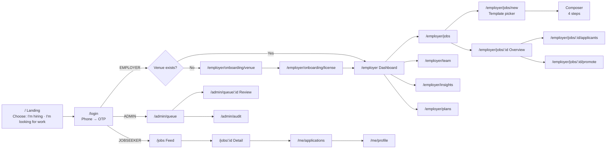
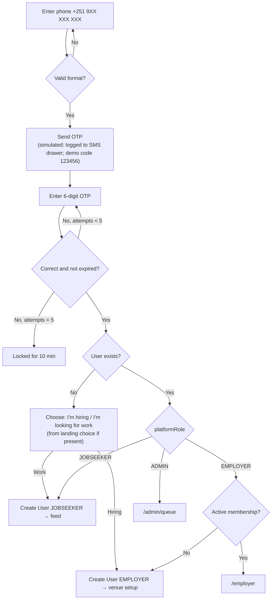
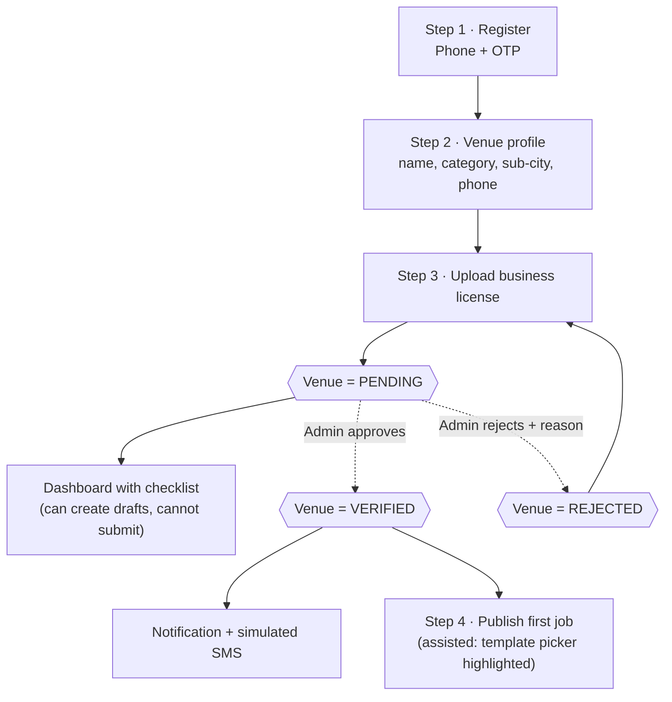
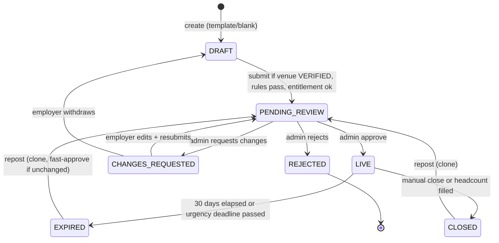
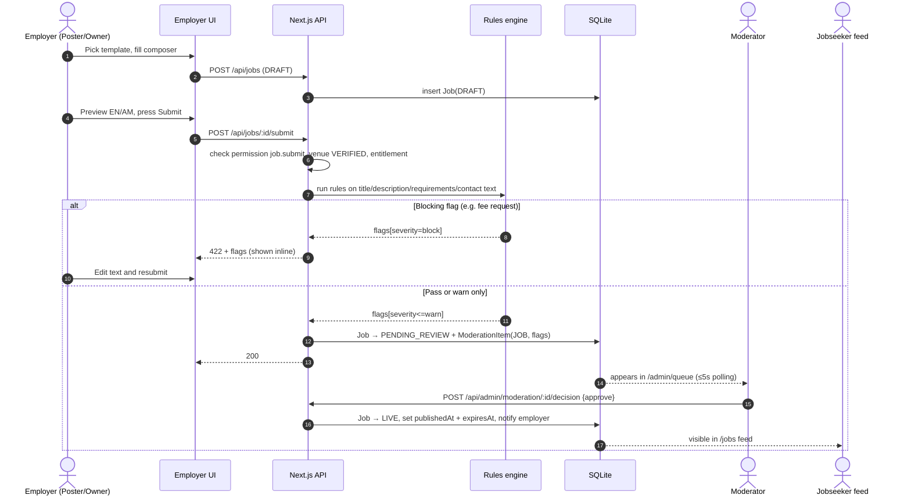
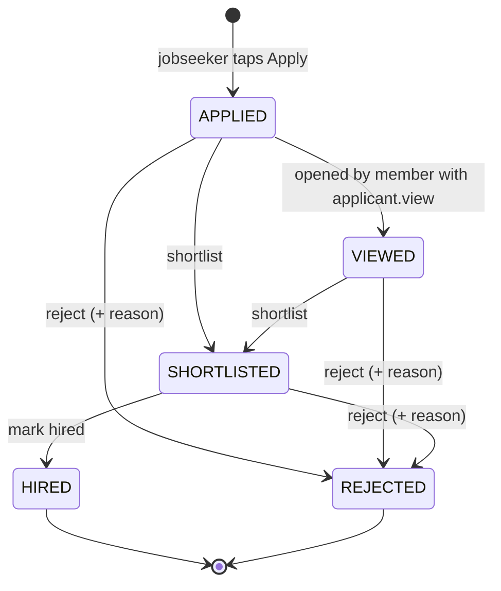
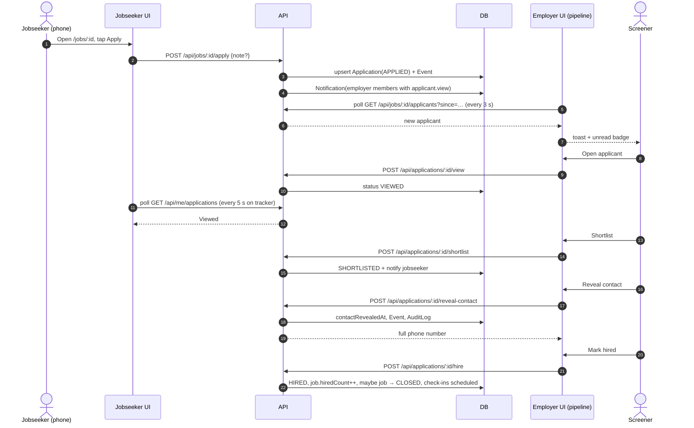
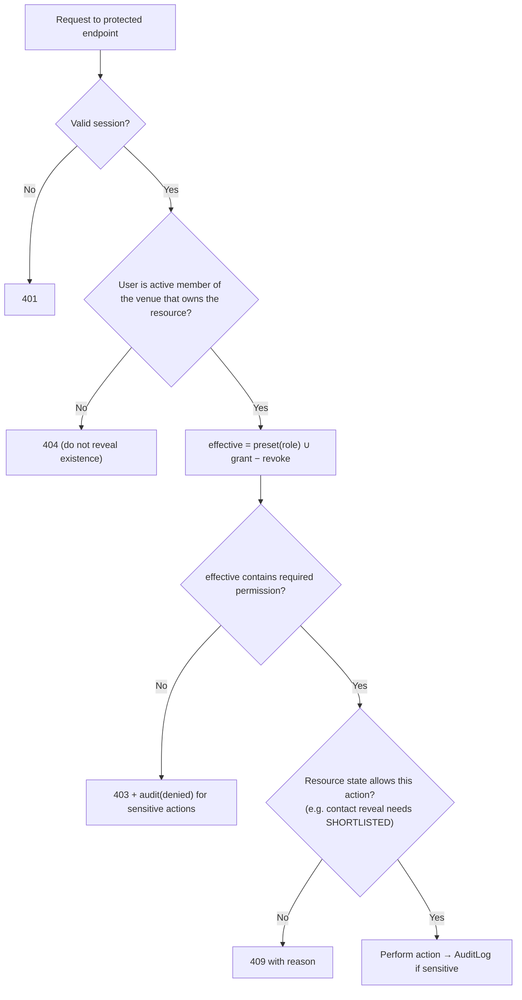
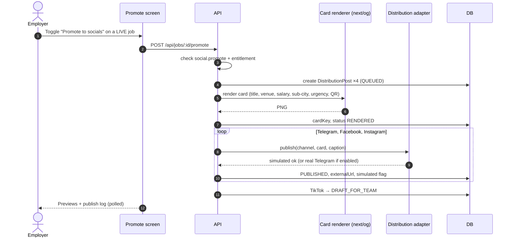
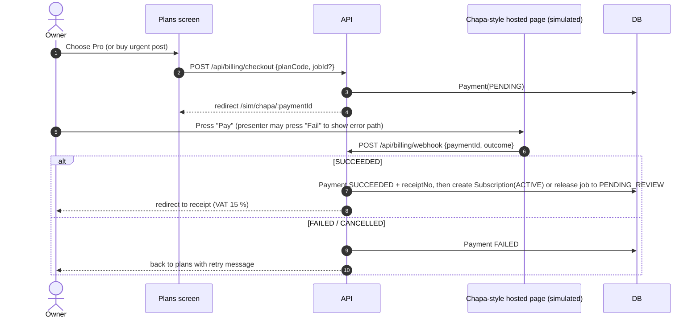

# Servaddis Demo — App Flow

| | |
|---|---|
| **Document** | 03 of 6 — Demo Specification Pack |
| **Version** | 0.1 (draft for review) · 29 Oct 2026 |
| **Depends on** | 01 PRD (requirement IDs E-/J-/A-/X-) · 05 Backend Schema (statuses, permissions) |
| **Used by** | 02 TRD (routes, APIs) · 04 UX/UI Brief (screens) · 06 Plan (build order) |

This document describes **how a user moves through the demo**: screen inventory, flows, state machines, rules that decide what a user sees, notifications, edge cases, and the presenter's script. Diagrams are Mermaid and render in GitHub, VS Code (with the Mermaid extension), and most Markdown viewers.

---

## 1. Screen inventory and route map

### 1.1 Global map

### 1.2 Screen table

`Perm` = permission key required (see doc 05 §5). Screens with no `Perm` are available to any signed-in member of that role.

| Screen | Route | Roles | Perm | Purpose | Key states | Req |
|---|---|---|---|---|---|---|
| SCR-00 Landing | `/` | public | — | Two big choices: "I'm hiring" / "I'm looking for work"; language toggle | — | X-01 |
| SCR-01 Sign-in | `/login` | public | — | Phone → OTP; demo hint "Use 123456" in demo mode | invalid phone · wrong OTP · locked after 5 tries · resend countdown | E-01 |
| SCR-E01 Venue setup | `/employer/onboarding/venue` | employer (no venue) | — | Name EN/AM, category, sub-city, phone, description | validation errors · saving | E-02 |
| SCR-E02 License upload | `/employer/onboarding/license` | owner | `venue.edit` | Upload license; see review state | empty · uploading · pending · rejected (with reason) · verified | E-03 |
| SCR-E03 Dashboard | `/employer` | member | — | Onboarding checklist, KPIs (live jobs, new applicants, time-to-fill), recent activity, "Post a job" CTA | new venue · pending verification · verified · expiring-soon banner | E-05, E-11 |
| SCR-E04 Jobs list | `/employer/jobs` | member | `job.view` | All jobs with status chips, applicant counts (counts only for Poster) | empty · filtered · mixed statuses | E-10 |
| SCR-E05 Template picker | `/employer/jobs/new` | member | `job.create` | 12 role templates + "Start blank" | locked banner if venue unverified (drafts allowed) | E-06 |
| SCR-E06 Composer | `/employer/jobs/new/compose` · `/employer/jobs/:id/edit` | member | `job.create` / `job.edit` | 4 steps: Basics → Details → Pay & urgency → Preview & submit | invalid · rules flags · submit disabled (unverified/no entitlement) | E-07…E-10 |
| SCR-E07 Job overview | `/employer/jobs/:id` | member | `job.view` | Status timeline, moderation feedback, expiry, actions (edit, close, repost, promote) | each JobStatus | E-10, E-11 |
| SCR-E08 Applicant pipeline | `/employer/jobs/:id/applicants` | member | `applicant.view` | Board/list; verified-first; sort; live arrivals | empty · live toast · filtered | E-12, E-19 |
| SCR-E09 Applicant drawer | overlay on E08 | member | `applicant.view` | Profile card, timeline, actions: shortlist / reject / hire / reveal contact | masked vs revealed contact · disabled actions with reason | E-13, E-14 |
| SCR-E10 Promote | `/employer/jobs/:id/promote` | member | `social.promote` | Toggle, card render, 4 channel previews, publish log | not entitled (upsell) · rendering · rendered · published (simulated) · TikTok draft | E-15 |
| SCR-E11 Plans | `/employer/plans` | owner | `billing.manage` | Compare plans; subscribe; buy urgent post; payment history | current plan · upgrade · pending payment | E-16 |
| SCR-E12 Checkout (sim) | `/sim/chapa/:paymentId` | owner | `billing.manage` | Chapa-styled hosted page; Pay / Fail / Cancel buttons for the presenter | pending · success · failed · cancelled | E-16 |
| SCR-E13 Receipt | `/employer/payments/:id` | owner | `billing.manage` | Receipt number, amount, VAT 15 %, print view | — | E-16 |
| SCR-E14 Team | `/employer/team` | owner | `team.manage` | Members list, invite by phone, role preset, per-permission toggles | invited (pending) · active · last-owner guard | E-17 |
| SCR-E15 Insights | `/employer/insights` | member | `insights.view` | Time-to-fill, funnel, applicants per job, quality trend | no data · seeded history | E-18 |
| SCR-E16 Venue profile | `/employer/venue` | owner | `venue.edit` | Edit venue details, see verification status and license | — | E-02 |
| SCR-J01 Jobs feed | `/jobs` | public / jobseeker | — | Mobile feed, filter sheet, urgent pinned | loading skeleton · empty · offline | J-01 |
| SCR-J02 Job detail | `/jobs/:id` | public / jobseeker | — | Full post, venue badge, **Apply** (sticky) | not signed in → OTP sheet · applied · job closed/expired | J-02, J-03 |
| SCR-J03 My applications | `/me/applications` | jobseeker | — | Tracker with status steps and timestamps | empty · each ApplicationStatus | J-04 |
| SCR-J04 Profile | `/me/profile` | jobseeker | — | Skills, languages, experience, completeness meter | read-mostly | J-05 |
| SCR-A01 Queue | `/admin/queue` | admin | `admin.moderate` | Tabs: Licenses · Jobs; age, flags, fast-approve tag | empty · filtered | A-01 |
| SCR-A02 Review | `/admin/queue/:id` | admin | `admin.moderate` | Doc viewer / job preview, rule flags, decision with reason | approve · request changes · reject | A-02, A-03 |
| SCR-A03 Audit | `/admin/audit` | admin | `admin.audit` | Filterable log of sensitive actions | — | A-04 |
| SCR-D01 Demo Toolkit | floating dock on every page (if `DEMO_MODE`) | presenter | — | Persona switcher, reset, simulate applicant, time-skip, phone drawer, tag toggle | collapsed · expanded | X-03 |

### 1.3 Persona switcher targets

| Label | Phone | Lands on | Venue / role |
|---|---|---|---|
| Bruk — new café owner | *(enter live)* or `+251911000011` | `/employer/onboarding/venue` | none yet |
| Selam — Hotel GM (Owner) | `+251911000001` | `/employer` | Hiwot Garden Hotel · Owner |
| Yared — HR officer (Poster) | `+251911000002` | `/employer` | Hiwot Garden Hotel · Poster |
| Rahel — HR manager (Screener) | `+251911000003` | `/employer` | Hiwot Garden Hotel · Screener |
| Dawit — Waiter | `+251922000001` | `/jobs` | Jobseeker |
| Moderator | `+251911000009` | `/admin/queue` | Admin |

## 2. Sign-in and role routing

**Invited staff:** when a member is invited by phone, the first sign-in with that phone links the `User` to the `VenueMember` row (status INVITED → ACTIVE) and lands on `/employer`.

## 3. Employer onboarding (E-01 … E-05)

**Checklist rules (dashboard):**

| Item | Complete when | CTA when incomplete |
|---|---|---|
| 1 Register | User exists | — |
| 2 Venue profile | Venue has name, category, sub-city, phone | "Complete venue profile" |
| 3 License | LicenseDocument uploaded (status PENDING counts as done-awaiting-review) | "Upload license" · shows reviewer feedback if REJECTED |
| 4 First job | ≥ 1 job reached LIVE | "Post your first job" · locked with explanation while unverified |

## 4. Job lifecycle

### 4.1 Job status machine

Notes:
- A **repost** creates a **new** `Job` row (`isRepost = true`, `repostOfId` set). The original keeps its history and applicants.
- Editing a LIVE job's material fields (title, salary, requirements) sends it back to PENDING_REVIEW; cosmetic fields (headcount, shift text) do not. (Material-field list in doc 05 §6.)
- Urgent jobs expire at their need-by time: Half-day = +12 h; Same-day = end of today (EAT); Next-day = end of tomorrow; Two-day = end of day after tomorrow. Otherwise `publishedAt + 30 days`.

### 4.2 Posting entitlement (decided at submit)

| Order | Condition | Result |
|---|---|---|
| 1 | Venue has ACTIVE subscription **and** live + pending jobs < plan `maxLiveJobs` (null = unlimited) | `postingSource = SUBSCRIPTION` |
| 2 | `foundingPostsLeft − pending founding jobs > 0` | `postingSource = FOUNDING_FREE` (counter decremented on approval) |
| 3 | Otherwise | Job stays DRAFT; employer is sent to **one-time urgent-post checkout**; on payment success → `URGENT_PAID` and the job moves to PENDING_REVIEW automatically |

**Promote to socials** is allowed when `postingSource` is `FOUNDING_FREE` or `URGENT_PAID`, or the active plan has `includesSocial`. Otherwise the Promote screen shows an upsell to Pro.

### 4.3 Create → moderate → publish (sequence)

### 4.4 Rules-engine decisions (what the employer sees)

| Rule | Severity | Example trigger | Employer-facing message (EN) |
|---|---|---|---|
| No fee requests | **block** | "registration fee", "deposit", "send money", "ክፍያ ይላኩ" | "Servaddis jobs must never ask applicants to pay. Remove this phrase to continue." |
| Blocked keywords list | **block** | seeded list of scam/adult-service terms | "This wording isn't allowed on Servaddis." |
| Missing/invalid salary | **block** | min = 0, or max < min | "Add a realistic salary range. Jobseekers see this first." |
| Off-platform contact in text | warn | phone number, Telegram handle, email in description | "Applicants contact you through Servaddis after you shortlist them." |
| Sensitive categories (e.g. spa, entertainment) | warn → forces manual review emphasis | role template family = SPA | (admin sees "enhanced scrutiny" tag) |
| Unrealistic salary vs template hint | warn | > 3× hint max or < 0.3× hint min | "This looks unusual for this role. Is it correct?" |
| Unchanged repost | info | contentHash equals original | admin sees "Unchanged repost — fast approve" |

## 5. Applicant pipeline

### 5.1 Application status machine

- **Contact reveal** is available only in `SHORTLISTED` or `HIRED`, requires `contact.reveal`, is idempotent, and writes `ApplicationEvent(CONTACT_REVEALED)` plus an `AuditLog` row.
- **Hire** requires `applicant.hire`. `job.hiredCount++`; when `hiredCount ≥ headcount` the job becomes `CLOSED` with `filledAt = now` and remaining non-final applicants are auto-set to `REJECTED (POSITION_FILLED)` with notification.
- **Time-to-fill** = `filledAt − publishedAt` (hours or days).
- **Verified-first ordering:** applicants with `faydaVerified = true` or `reliabilityScore ≥ 4.0` sort first; then by chosen sort (profile completeness desc, or experience desc).

### 5.2 Applicant journey (jobseeker ↔ employer)

## 6. Team permissions flow (E-17, X-02)

### 6.1 Role presets

| Permission | Owner | HR Manager | Poster | Screener | Viewer |
|---|:-:|:-:|:-:|:-:|:-:|
| View jobs | ✔ | ✔ | ✔ | ✔ | ✔ |
| Create / edit jobs | ✔ | ✔ | ✔ | — | — |
| Submit job for review | ✔ | ✔ | ✔ | — | — |
| Close / repost job | ✔ | ✔ | ✔ | — | — |
| Promote to socials | ✔ | ✔ | ✔ | — | — |
| View applicants | ✔ | ✔ | — | ✔ | — |
| Shortlist | ✔ | ✔ | — | ✔ | — |
| Reject | ✔ | ✔ | — | ✔ | — |
| Mark hired | ✔ | ✔ | — | — | — |
| Reveal contact | ✔ | ✔ | — | ✔ | — |
| View insights | ✔ | ✔ | — | — | ✔ |
| Billing & plans | ✔ | — | — | — | — |
| Manage team | ✔ | — | — | — | — |
| Edit venue profile | ✔ | — | — | — | — |

Poster sees **applicant counts** on the jobs list (open question Q3 in PRD) but no applicant identities. Per-member **grant/revoke** overrides can change any cell for a specific person. Full permission keys are in doc 05 §5.

### 6.2 Authorization decision

### 6.3 Invite flow

1. Owner opens **Team** → *Invite member* → name, phone, role preset, optional toggles.
2. System creates `VenueMember(status = INVITED, invitedPhone)` and logs a simulated SMS invite ("Hiwot Garden Hotel invited you to Servaddis").
3. Invitee signs in with that phone → membership becomes ACTIVE.
4. Owner may change role/toggles at any time; effects apply to the **next** request. Removing a member sets `REMOVED`; their sessions can no longer access venue data.
5. **Guards:** the last Owner cannot be removed or downgraded; an Owner cannot revoke their own `team.manage`.

## 7. Promote to socials (E-15)

Previews show: Telegram post (card + caption + button "Apply on Servaddis"), Facebook post, Instagram square with caption, TikTok "Draft awaiting team (add trending sound)". Captions are generated from a bilingual template, not an LLM, so output is deterministic for demos.

## 8. Plans and checkout (E-16)

**Illustrative pricing (placeholder — not from your documents):**

| Plan | Kind | Price (ETB, ex-VAT) | Live jobs | Socials |
|---|---|--:|:-:|:-:|
| Founding Partner | one-time perk | 0 | 3 free posts | ✔ |
| Urgent Post | one-time | 300 | 1 job | ✔ |
| Standard | subscription / 30 days | 1,500 | 5 | — |
| Pro | subscription / 30 days | 3,500 | unlimited | ✔ + priority placement |

## 9. Demo script (≈ 10 minutes)

**Setup:** presenter laptop with two browser windows side by side (**Employer**, **Admin**), one phone (or a phone-sized window) for the **Jobseeker**, Demo Toolkit open on the laptop. Run **Reset** before starting. Wi-Fi fallback and offline plan in doc 06 §8.

| # | Time | On screen | Presenter does | Say (summary) | Expected result |
|---|---|---|---|---|---|
| 0 | 0:00 | Slide: unstructured Telegram post vs Servaddis post | — | "Telegram broadcasts; hotels need a hiring workflow: structured, verified, trackable." | Context set |
| 1 | 1:00 | SCR-00 → SCR-01 | Open `/`, tap **I'm hiring**, enter Bruk's number, OTP | "Registration is a phone number — no email, no CV." | Lands on venue setup |
| 2 | 1:30 | SCR-E01 | Toggle to Amharic, fill *Bole Sunrise Café*, category Café, sub-city Bole | "Amharic-first, English equal." | Venue saved |
| 3 | 2:15 | SCR-E02 | Upload sample license PDF | "We verify the business before any job goes live." | Status **Pending verification**; dashboard checklist 3/4 |
| 4 | 2:45 | **Admin window** SCR-A01/A02 | Open license, **Approve** | "A human checks every license; pre-publication moderation is 100 %." | Employer window shows **Verified** badge + notification (≤5 s) |
| 5 | 3:30 | SCR-E05 → E06 | **Post a job** → *Barista* template → adjust salary → open **Preview** in Amharic | "A complete post in minutes, bilingual by default." | Composer pre-filled |
| 6 | 4:30 | SCR-E06 step 4 | Add the sentence "registration fee ETB 200" → **Submit** → blocked → remove → submit | "The rules engine blocks fee requests — trust is the product." | Inline block message, then *In review* |
| 7 | 5:00 | Admin → approve job | Approve in Admin window | — | Job **Live**; appears on phone feed |
| 8 | 5:15 | **Phone** SCR-J01/J02 | Dawit signs in, taps **Apply** | "One tap, no CV." | Applicant toast on employer screen ≤5 s |
| 9 | 5:45 | SCR-E08/E09 | Open applicant (→ Viewed), try **Reveal contact** (disabled), **Shortlist**, **Reveal contact**, **Mark hired** | "Contact stays hidden until you shortlist — protects jobseekers." | Phone tracker updates; job closes (headcount 1); time-to-fill shows |
| 10 | 6:45 | Persona switcher → **Selam (Owner)**, SCR-E14 | Show Team: Yared = Poster, Rahel = Screener; toggle one permission | "Your GM, HR officer and screener don't need the same powers." | Team table |
| 11 | 7:15 | Switch to **Yared** | Show jobs yes, applicants no (403 page), no billing | "Posting and hiring decisions can be separated." | Permission-aware UI |
| 12 | 7:45 | Switch to **Rahel** | Show applicants yes, *New job* hidden | — | Permission-aware UI |
| 13 | 8:00 | Back to Selam → SCR-E10 | Open a Live job → **Promote** → card renders → previews/publish log | "One click, four channels, bilingual." | Card + log, *Simulated* tags |
| 14 | 8:45 | SCR-E11 → E12 → E13 | Show plans; Standard shows Promote locked → upgrade to Pro → **Pay** → receipt | "Subscription is the revenue engine." | Receipt with VAT; Promote unlocked |
| 15 | 9:30 | SCR-E15 | Open Insights | "Time-to-fill and funnel give employers a reason to renew." | Seeded charts |
| 16 | 9:45 | Slide: real vs simulated | — | Honest scope + ask | Close |

**Fallbacks the presenter can trigger from the Toolkit:** *Simulate applicant* (if the phone fails), *Approve all pending* (if the admin window is not available), *Skip to state…* (jump to "venue verified", "job live", "applicants present", "job hired").

## 10. Notification matrix

| Event | Recipient | In-app (bell) | Simulated SMS | Deep link |
|---|---|:-:|:-:|---|
| Venue verified | venue Owner | ✔ | ✔ | `/employer` |
| Venue rejected (reason) | venue Owner | ✔ | ✔ | `/employer/onboarding/license` |
| Job approved | job creator + Owner | ✔ | — | `/employer/jobs/:id` |
| Changes requested | job creator | ✔ | ✔ | `/employer/jobs/:id/edit` |
| Job rejected | job creator + Owner | ✔ | ✔ | `/employer/jobs/:id` |
| Job expiring (T-3 d) | job creator + Owner | ✔ | — | `/employer/jobs/:id` |
| Application received | members with `applicant.view` | ✔ + toast | — | `/employer/jobs/:id/applicants` |
| Application viewed / shortlisted / rejected | jobseeker | ✔ | ✔ (shortlisted) | `/me/applications` |
| Hired | jobseeker | ✔ | ✔ | `/me/applications` |
| Job filled | job creator + Owner | ✔ | — | `/employer/jobs/:id` |
| Staff invited | invitee | — | ✔ | `/login` |
| Payment receipt | Owner | ✔ | ✔ | `/employer/payments/:id` |
| 2-week check-in due (via time-skip) | employer + jobseeker | ✔ | ✔ | — |

Notification text is stored in both languages (`titleEn/titleAm`) and displayed in the recipient's locale.

## 11. Edge cases and error states

| Situation | Behaviour |
|---|---|
| Unverified venue tries to submit | Submit button disabled; inline explainer + link to license status; drafts still saved |
| Venue REJECTED | Reviewer reason shown on dashboard and license page; upload replaced and re-queued |
| No entitlement | Submit routes to urgent-post checkout; job is held in DRAFT until payment succeeds |
| Duplicate Apply tap | Idempotent: second call returns existing application (no duplicate row — unique `(jobId, jobseekerId)`) |
| Apply to closed/expired job | Apply button replaced with "This job is no longer open"; API returns 409 |
| Applicant action on terminal state | UI disables; API 409 with current status |
| Reveal contact before shortlist | Button disabled with tooltip "Shortlist first"; API 409 |
| Last Owner removal/downgrade | Blocked with message |
| Direct URL to another venue's job | 404 (no existence leak) |
| Poster opens `/employer/jobs/:id/applicants` | 403 page: "Your role can't view applicants. Ask the owner." |
| Upload invalid (type/size) | Inline error before upload; server revalidates |
| OTP wrong ×5 | 10-minute lockout; message in both languages |
| Offline | Jobseeker routes show offline shell and "You're offline" toast; Apply queued locally is **not** supported in demo (button disabled offline) |
| Demo reset during session | All sessions invalidated; presenter lands on `/` |
| Time-skip past expiry | Cron-equivalent job sweep runs immediately: LIVE → EXPIRED, notifications created |

## 12. Language behaviour

- Language toggle (**አማ | EN**) is in the top bar on every screen; choice is stored on the `User.locale` (signed-in) or a cookie (anonymous).
- Default locale: **Amharic** for jobseekers and for the demo landing page; **English** option one tap away. Employer default follows the browser/cookie; Demo Toolkit can force a language.
- **Content** (job titles/descriptions) is authored per language: composer has EN and AM tabs; template fills both; if the employer fills only one language, preview shows the other as "Not provided" and the feed falls back to the available language with a small "EN"/"AM" tag.
- Numbers use Western digits in both languages for salary (ETB 12,000). Dates use Gregorian by default with an optional Ethiopian-calendar line in the job detail (stretch).
