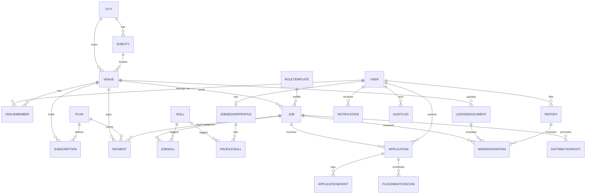

# Servaddis Demo — Backend Schema

| | |
|---|---|
| **Document** | 05 of 6 — Demo Specification Pack |
| **Version** | 0.1 (draft for review) · 29 Oct 2026 |
| **Database** | SQLite 3 via Prisma 6.x (demo) — designed to port to MySQL 8 (production target in the proposal) |
| **Depends on** | 01 PRD · 03 App Flow |
| **Validated** | The Prisma schema in §4 was validated with Prisma's schema parser (no errors) |

This document is the single source of truth for **data**: entities, enums, relationships, permissions, state machines, seed data, and how the demo schema maps to the production plan.

---

## 1. Design principles

1. **Production-shaped, demo-sized.** Same entities a real build needs (venues, members, jobs, applications, moderation, payments), without anything that only matters at scale.
2. **City is first-class.** `City` and `SubCity` exist from day one; only Addis is enabled (proposal §5 "Multi-city readiness").
3. **Bilingual by column.** User-facing content has `…En` and `…Am` columns (or a JSON pair), not a translation table — simpler for a demo and trivial to extend later.
4. **Integer ETB.** Money is stored as whole birr (`Int`). VAT = 15 %, rounded to the nearest birr.
5. **Enums for states.** Every lifecycle is an enum plus timestamps, so the UI and tests read the same vocabulary.
6. **Audit by default for sensitive actions.** Contact reveals, moderation decisions, permission changes and payments write `AuditLog`.
7. **JSON only for display lists.** Stored as `String` containing JSON (portable across SQLite and MySQL). Anything filtered, joined or counted is relational.
8. **No real personal data.** Seeds are fictional; `isDemoSeed` marks them; Fayda is a boolean flag, never a stored ID number.

## 2. Entity-relationship overview



## 3. Entity catalogue

| Entity | Purpose | Key fields | Notes |
|---|---|---|---|
| `City`, `SubCity` | Geography; Addis Ababa's 11 sub-cities seeded | `slug`, `nameEn/Am`, `isLaunch` | Other corridor cities seeded with `isLaunch = false` |
| `User` | Every person who signs in | `phone` (unique, E.164), `platformRole`, `locale`, `faydaVerified` | One phone = one account. Role chosen at first sign-in; ADMIN is seed-only |
| `Otp` | OTP attempts | `codeHash`, `expiresAt`, `attempts`, `consumedAt` | Demo mode accepts the fixed code `123456` but still writes the row and enforces lockout |
| `Venue` | The employing institution | `category`, `verification`, `foundingPostsLeft` | One user may belong to several venues in production; demo uses one |
| `VenueMember` | Staff access to a venue | `role`, `grant[]`, `revoke[]`, `status`, `invitedPhone` | Effective permissions = preset(role) ∪ grant − revoke (§5) |
| `LicenseDocument` | Uploaded business license | `fileKey`, `mime`, `sizeBytes`, `status`, `rejectionReason` | File stored outside web root; served through an authorized endpoint |
| `RoleTemplate` | Hospitality role taxonomy + defaults | `slug`, `family`, `defaults` JSON | 12 seeded (§9.2) |
| `Skill` | Skill tags (e.g. Barista, Espresso, Amharic, English) | `slug`, `group` | Used on jobs and profiles |
| `Job` | A posting | `status`, `salaryMin/Max/Period`, `urgency`, `needByAt`, `postingSource`, `hiredCount`, `publishedAt/expiresAt/filledAt` | Reposts are new rows linked by `repostOfId` |
| `JobSkill` | Job ↔ skill | composite PK | |
| `JobseekerProfile` | No-CV profile | `experienceYears`, `languages`, `completeness`, `reliabilityScore` | Completeness recomputed on write (§6.4) |
| `ProfileSkill` | Profile ↔ skill | composite PK | |
| `Application` | One jobseeker's application to a job | `status`, timestamps per stage, `contactRevealedAt`, `rejectReason` | Unique `(jobId, jobseekerId)` makes apply idempotent |
| `ApplicationEvent` | Timeline of an application | `type`, `actorId`, `at` | Source for the tracker and insights |
| `PlacementCheckin` | 2-week / 30-day check-ins after a hire | `kind`, `dueAt`, answers | Feeds reliability (stretch) |
| `ModerationItem` | Queue entry for a license, job or report | `type`, `status`, `flags`, `isFastApprove` | One open item per target at a time |
| `Report` | Jobseeker reports a job/venue | `target`, `reason` | P2 |
| `AuditLog` | Who did what to what | `action`, `entity`, `entityId`, `meta` | Append-only |
| `Plan`, `Subscription`, `Payment` | Monetisation | `priceEtb`, `kind`, `status`, `receiptNo` | Prices are **placeholders** |
| `DistributionPost` | One row per channel per promoted job | `channel`, `status`, `simulated`, `cardKey` | Unique `(jobId, channel)` |
| `Notification` | In-app notifications (bilingual) | `kind`, `titleEn/Am`, `readAt`, `href` | |
| `SmsLog` | Simulated SMS gateway outbox | `toPhone`, `body`, `kind` | Displayed in the Demo Toolkit phone drawer |
| `DemoSetting` | Key/value for demo state | `clock_offset_ms`, `scenario` | Drives time-skip (§8) |

## 4. Prisma schema

> Prisma 6.x. If you adopt Prisma 7, remove the `url` line from the `datasource` block and pass the connection through `prisma.config.ts` and a driver adapter (TRD §3 notes this). Enums on SQLite require Prisma ≥ 6.2.

```prisma
// Servaddis Demo — Prisma schema (SQLite for demo; portable to MySQL 8)
// Money is stored as integer ETB (no decimals) to avoid float issues.
// JSON columns are used only for display-time lists; anything filtered/joined is relational.

generator client {
  provider = "prisma-client-js"
}

datasource db {
  provider = "sqlite"
  url      = env("DATABASE_URL")
}

// ───────────────────────── Enums ─────────────────────────

enum PlatformRole {
  EMPLOYER
  JOBSEEKER
  ADMIN
}

enum Locale {
  AM
  EN
}

enum VenueCategory {
  HOTEL
  RESTAURANT
  CAFE
  CATERING
  TOUR_OPERATOR
  GUESTHOUSE
  SPA
}

enum VerificationStatus {
  UNSUBMITTED
  PENDING
  VERIFIED
  REJECTED
}

enum MemberRole {
  OWNER
  HR_MANAGER
  POSTER
  SCREENER
  VIEWER
}

enum MemberStatus {
  INVITED
  ACTIVE
  REMOVED
}

enum EmploymentType {
  FULL_TIME
  PART_TIME
  CONTRACT
  SHIFT
}

enum SalaryPeriod {
  MONTH
  DAY
  SHIFT
}

enum Urgency {
  NORMAL
  HALF_DAY
  SAME_DAY
  NEXT_DAY
  TWO_DAYS
}

enum JobStatus {
  DRAFT
  PENDING_REVIEW
  CHANGES_REQUESTED
  LIVE
  EXPIRED
  CLOSED
  REJECTED
}

enum PostingSource {
  FOUNDING_FREE
  SUBSCRIPTION
  URGENT_PAID
}

enum ApplicationStatus {
  APPLIED
  VIEWED
  SHORTLISTED
  REJECTED
  HIRED
}

enum RejectReason {
  NOT_ENOUGH_EXPERIENCE
  SKILLS_MISMATCH
  LANGUAGE_REQUIREMENT
  AVAILABILITY_MISMATCH
  POSITION_FILLED
  OTHER
}

enum ModerationType {
  LICENSE
  JOB
  REPORT
}

enum ModerationStatus {
  PENDING
  APPROVED
  REJECTED
  CHANGES_REQUESTED
}

enum PlanKind {
  SUBSCRIPTION
  ONE_TIME
}

enum SubscriptionStatus {
  ACTIVE
  CANCELLED
  EXPIRED
}

enum PaymentProvider {
  CHAPA_SIM
  BANK_TRANSFER_SIM
}

enum PaymentStatus {
  PENDING
  SUCCEEDED
  FAILED
}

enum Channel {
  TELEGRAM
  FACEBOOK
  INSTAGRAM
  TIKTOK
}

enum DistributionStatus {
  QUEUED
  RENDERED
  PUBLISHED
  DRAFT_FOR_TEAM
  FAILED
}

enum NotificationKind {
  VENUE_VERIFIED
  VENUE_REJECTED
  JOB_APPROVED
  JOB_CHANGES_REQUESTED
  JOB_REJECTED
  JOB_EXPIRING
  JOB_FILLED
  APPLICATION_RECEIVED
  APPLICATION_VIEWED
  APPLICATION_SHORTLISTED
  APPLICATION_REJECTED
  APPLICATION_HIRED
  STAFF_INVITED
  PAYMENT_RECEIPT
  CHECKIN_DUE
}

enum CheckinKind {
  WEEK_2
  DAY_30
}

enum ReportTarget {
  JOB
  VENUE
}

// ───────────────────────── Geography ─────────────────────────

model City {
  id        String    @id @default(cuid())
  slug      String    @unique
  nameEn    String
  nameAm    String
  isLaunch  Boolean   @default(false) // Addis only at launch; others seeded but disabled
  subCities SubCity[]
  venues    Venue[]
  jobs      Job[]
}

model SubCity {
  id     String @id @default(cuid())
  cityId String
  slug   String @unique
  nameEn String
  nameAm String
  city   City   @relation(fields: [cityId], references: [id])
  venues Venue[]
  jobs   Job[]

  @@index([cityId])
}

// ───────────────────────── Identity ─────────────────────────

model User {
  id            String       @id @default(cuid())
  phone         String       @unique // E.164, e.g. +251911000001
  name          String
  platformRole  PlatformRole
  locale        Locale       @default(AM)
  faydaVerified Boolean      @default(false) // simulated in demo; never store a real FIN
  isDemoSeed    Boolean      @default(false)
  createdAt     DateTime     @default(now())
  lastLoginAt   DateTime?

  memberships       VenueMember[]
  profile           JobseekerProfile?
  applications      Application[]
  notifications     Notification[]
  jobsCreated       Job[]               @relation("JobCreator")
  moderationReviews ModerationItem[]    @relation("ModerationReviewer")
  licenseReviews    LicenseDocument[]   @relation("LicenseReviewer")
  reports           Report[]
  auditLogs         AuditLog[]
  contactReveals    Application[]       @relation("ContactRevealer")
}

model Otp {
  id          String    @id @default(cuid())
  phone       String
  codeHash    String
  expiresAt   DateTime
  attempts    Int       @default(0)
  consumedAt  DateTime?
  createdAt   DateTime  @default(now())

  @@index([phone, createdAt])
}

// ───────────────────────── Employers ─────────────────────────

model Venue {
  id                  String             @id @default(cuid())
  nameEn              String
  nameAm              String?
  category            VenueCategory
  cityId              String
  subCityId           String
  address             String?
  contactPhone        String
  descriptionEn       String?
  descriptionAm       String?
  logoUrl             String?
  verification        VerificationStatus @default(UNSUBMITTED)
  verifiedAt          DateTime?
  foundingPostsLeft   Int                @default(3) // founding-partner free postings (business plan §5.2)
  onboardingDismissed Boolean            @default(false)
  createdAt           DateTime           @default(now())

  city          City              @relation(fields: [cityId], references: [id])
  subCity       SubCity           @relation(fields: [subCityId], references: [id])
  members       VenueMember[]
  licenses      LicenseDocument[]
  jobs          Job[]
  subscriptions Subscription[]
  payments      Payment[]
  reports       Report[]

  @@index([verification])
  @@index([cityId, subCityId])
}

model VenueMember {
  id            String       @id @default(cuid())
  venueId       String
  userId        String?      // null until the invitee signs in with the invited phone
  invitedPhone  String?
  displayName   String
  role          MemberRole
  grant         String       @default("[]") // JSON string[] of extra permission keys
  revoke        String       @default("[]") // JSON string[] of permission keys removed from the preset
  status        MemberStatus @default(ACTIVE)
  createdAt     DateTime     @default(now())

  venue Venue @relation(fields: [venueId], references: [id], onDelete: Cascade)
  user  User? @relation(fields: [userId], references: [id])

  @@unique([venueId, userId])
  @@unique([venueId, invitedPhone])
  @@index([userId])
}

model LicenseDocument {
  id              String       @id @default(cuid())
  venueId         String
  fileKey         String       // storage key, never a public URL
  fileName        String
  mime            String
  sizeBytes       Int
  status          ModerationStatus @default(PENDING)
  reviewedById    String?
  reviewedAt      DateTime?
  rejectionReason String?
  uploadedAt      DateTime     @default(now())

  venue      Venue            @relation(fields: [venueId], references: [id], onDelete: Cascade)
  reviewedBy User?            @relation("LicenseReviewer", fields: [reviewedById], references: [id])
  moderation ModerationItem[]

  @@index([venueId])
}

// ───────────────────────── Taxonomy ─────────────────────────

model Skill {
  id     String @id @default(cuid())
  slug   String @unique
  nameEn String
  nameAm String
  group  String // e.g. "service", "kitchen", "language", "tourism"

  jobs     JobSkill[]
  profiles ProfileSkill[]
}

model RoleTemplate {
  id          String @id @default(cuid())
  slug        String @unique
  nameEn      String
  nameAm      String
  family      String // FRONT_OF_HOUSE | KITCHEN | HOUSEKEEPING | SPA | TOURISM | MANAGEMENT | BAR
  defaults    String // JSON: {employmentType, shiftPattern, salaryHint:{min,max,period}, requirementsEn[], requirementsAm[], benefitsEn[], benefitsAm[], skillSlugs[]}
  sortOrder   Int    @default(0)

  jobs Job[]
}

// ───────────────────────── Jobs ─────────────────────────

model Job {
  id               String         @id @default(cuid())
  venueId          String
  createdById      String
  roleTemplateId   String?
  titleEn          String
  titleAm          String?
  descriptionEn    String
  descriptionAm    String?
  headcount        Int            @default(1)
  employmentType   EmploymentType
  shiftPattern     String?
  salaryMin        Int            // ETB — mandatory (EM-02)
  salaryMax        Int
  salaryPeriod     SalaryPeriod   @default(MONTH)
  requirementsEn   String         @default("[]") // JSON string[]
  requirementsAm   String         @default("[]")
  benefitsEn       String         @default("[]")
  benefitsAm       String         @default("[]")
  languagesNeeded  String         @default("[]") // JSON string[] of "am" | "en" | "om" | ...
  cityId           String
  subCityId        String
  urgency          Urgency        @default(NORMAL)
  needByAt         DateTime?      // set when urgency != NORMAL
  status           JobStatus      @default(DRAFT)
  postingSource    PostingSource?
  promoteToSocials Boolean        @default(false)
  isRepost         Boolean        @default(false)
  repostOfId       String?
  contentHash      String?        // detects "unchanged repost"
  hiredCount       Int            @default(0)
  submittedAt      DateTime?
  publishedAt      DateTime?
  expiresAt        DateTime?
  filledAt         DateTime?
  closedAt         DateTime?
  createdAt        DateTime       @default(now())
  updatedAt        DateTime       @updatedAt

  venue        Venue            @relation(fields: [venueId], references: [id], onDelete: Cascade)
  createdBy    User             @relation("JobCreator", fields: [createdById], references: [id])
  roleTemplate RoleTemplate?    @relation(fields: [roleTemplateId], references: [id])
  city         City             @relation(fields: [cityId], references: [id])
  subCity      SubCity          @relation(fields: [subCityId], references: [id])
  repostOf     Job?             @relation("Repost", fields: [repostOfId], references: [id])
  reposts      Job[]            @relation("Repost")
  skills       JobSkill[]
  applications Application[]
  moderation   ModerationItem[]
  distribution DistributionPost[]
  payments     Payment[]
  reports      Report[]

  @@index([venueId, status])
  @@index([status, publishedAt])
  @@index([status, subCityId])
  @@index([expiresAt])
}

model JobSkill {
  jobId   String
  skillId String
  job     Job   @relation(fields: [jobId], references: [id], onDelete: Cascade)
  skill   Skill @relation(fields: [skillId], references: [id])

  @@id([jobId, skillId])
}

// ───────────────────────── Jobseekers ─────────────────────────

model JobseekerProfile {
  userId             String   @id
  headline           String?
  experienceYears    Int      @default(0)
  languages          String   @default("[]") // JSON: [{code:"am",level:"native"}, ...]
  previousWorkplaces String   @default("[]") // JSON: [{name, role, years}]
  expectedSalaryMin  Int?
  availability       String?  // free text for demo: "Weekends + evenings"
  preferredSubCities String   @default("[]") // JSON string[] of SubCity slugs
  photoUrl           String?
  completeness       Int      @default(0) // 0–100, recomputed on write
  reliabilityScore   Float?   // null until >= 1 completed check-in
  reliabilityCount   Int      @default(0)
  updatedAt          DateTime @updatedAt

  user   User           @relation(fields: [userId], references: [id], onDelete: Cascade)
  skills ProfileSkill[]
}

model ProfileSkill {
  profileId String
  skillId   String
  profile   JobseekerProfile @relation(fields: [profileId], references: [userId], onDelete: Cascade)
  skill     Skill            @relation(fields: [skillId], references: [id])

  @@id([profileId, skillId])
}

// ───────────────────────── Applications ─────────────────────────

model Application {
  id                String            @id @default(cuid())
  jobId             String
  jobseekerId       String
  note              String?
  status            ApplicationStatus @default(APPLIED)
  rejectReason      RejectReason?
  appliedAt         DateTime          @default(now())
  viewedAt          DateTime?
  shortlistedAt     DateTime?
  rejectedAt        DateTime?
  hiredAt           DateTime?
  contactRevealedAt DateTime?
  contactRevealedById String?

  job             Job                  @relation(fields: [jobId], references: [id], onDelete: Cascade)
  jobseeker       User                 @relation(fields: [jobseekerId], references: [id])
  contactRevealer User?                @relation("ContactRevealer", fields: [contactRevealedById], references: [id])
  events          ApplicationEvent[]
  checkins        PlacementCheckin[]

  @@unique([jobId, jobseekerId])
  @@index([jobId, status])
  @@index([jobseekerId])
}

model ApplicationEvent {
  id            String   @id @default(cuid())
  applicationId String
  actorId       String?
  type          String   // APPLIED | VIEWED | SHORTLISTED | REJECTED | HIRED | CONTACT_REVEALED
  meta          String?  // JSON
  at            DateTime @default(now())

  application Application @relation(fields: [applicationId], references: [id], onDelete: Cascade)

  @@index([applicationId, at])
}

model PlacementCheckin {
  id            String      @id @default(cuid())
  applicationId String
  kind          CheckinKind
  dueAt         DateTime
  sentAt        DateTime?
  employerOk    Boolean?
  jobseekerOk   Boolean?

  application Application @relation(fields: [applicationId], references: [id], onDelete: Cascade)

  @@unique([applicationId, kind])
}

// ───────────────────────── Moderation & trust ─────────────────────────

model ModerationItem {
  id           String           @id @default(cuid())
  type         ModerationType
  status       ModerationStatus @default(PENDING)
  jobId        String?
  licenseId    String?
  reportId     String?
  flags        String           @default("[]") // JSON: [{rule, severity, message}]
  reviewerId   String?
  reason       String?
  isFastApprove Boolean         @default(false) // unchanged repost
  createdAt    DateTime         @default(now())
  decidedAt    DateTime?

  job      Job?             @relation(fields: [jobId], references: [id], onDelete: Cascade)
  license  LicenseDocument? @relation(fields: [licenseId], references: [id], onDelete: Cascade)
  report   Report?          @relation(fields: [reportId], references: [id])
  reviewer User?            @relation("ModerationReviewer", fields: [reviewerId], references: [id])

  @@index([status, type, createdAt])
}

model Report {
  id         String       @id @default(cuid())
  reporterId String
  target     ReportTarget
  jobId      String?
  venueId    String?
  reason     String
  createdAt  DateTime     @default(now())

  reporter   User             @relation(fields: [reporterId], references: [id])
  job        Job?             @relation(fields: [jobId], references: [id])
  venue      Venue?           @relation(fields: [venueId], references: [id])
  moderation ModerationItem[]
}

model AuditLog {
  id       String   @id @default(cuid())
  actorId  String?
  action   String   // e.g. "job.approve", "application.contact_reveal", "team.permission_change"
  entity   String
  entityId String
  meta     String?  // JSON
  at       DateTime @default(now())

  actor User? @relation(fields: [actorId], references: [id])

  @@index([entity, entityId])
  @@index([at])
}

// ───────────────────────── Money ─────────────────────────

model Plan {
  id            String   @id @default(cuid())
  code          String   @unique // FOUNDING | URGENT_POST | STANDARD | PRO
  kind          PlanKind
  nameEn        String
  nameAm        String
  priceEtb      Int      // ex-VAT, ILLUSTRATIVE placeholder pricing
  periodDays    Int?     // SUBSCRIPTION only
  maxLiveJobs   Int?     // null = unlimited
  includesSocial Boolean @default(false)
  features      String   @default("[]") // JSON string[] of feature keys for display
  isActive      Boolean  @default(true)
  sortOrder     Int      @default(0)

  subscriptions Subscription[]
  payments      Payment[]
}

model Subscription {
  id                 String             @id @default(cuid())
  venueId            String
  planId             String
  status             SubscriptionStatus @default(ACTIVE)
  currentPeriodStart DateTime
  currentPeriodEnd   DateTime
  cancelledAt        DateTime?

  venue Venue @relation(fields: [venueId], references: [id], onDelete: Cascade)
  plan  Plan  @relation(fields: [planId], references: [id])

  @@index([venueId, status])
}

model Payment {
  id          String          @id @default(cuid())
  venueId     String
  planId      String
  jobId       String?         // set for ONE_TIME urgent posts
  amountEtb   Int             // ex-VAT
  vatEtb      Int             // 15% — rounded to nearest ETB
  provider    PaymentProvider
  providerRef String?
  status      PaymentStatus   @default(PENDING)
  receiptNo   String?         @unique
  createdAt   DateTime        @default(now())
  paidAt      DateTime?

  venue Venue @relation(fields: [venueId], references: [id])
  plan  Plan  @relation(fields: [planId], references: [id])
  job   Job?  @relation(fields: [jobId], references: [id])

  @@index([venueId, createdAt])
}

// ───────────────────────── Distribution & messaging ─────────────────────────

model DistributionPost {
  id          String             @id @default(cuid())
  jobId       String
  channel     Channel
  status      DistributionStatus @default(QUEUED)
  captionEn   String
  captionAm   String
  hashtags    String             @default("[]")
  cardKey     String?            // rendered image key
  externalUrl String?
  simulated   Boolean            @default(true)
  publishedAt DateTime?
  error       String?
  createdAt   DateTime           @default(now())

  job Job @relation(fields: [jobId], references: [id], onDelete: Cascade)

  @@unique([jobId, channel])
}

model Notification {
  id        String           @id @default(cuid())
  userId    String
  kind      NotificationKind
  titleEn   String
  titleAm   String
  bodyEn    String?
  bodyAm    String?
  href      String?
  readAt    DateTime?
  createdAt DateTime         @default(now())

  user User @relation(fields: [userId], references: [id], onDelete: Cascade)

  @@index([userId, readAt, createdAt])
}

model SmsLog {
  id        String   @id @default(cuid())
  toPhone   String
  body      String
  kind      String   // OTP | ALERT | CHECKIN | INVITE
  createdAt DateTime @default(now())
  // Simulated gateway: rows are shown in the Demo Toolkit "Phone" drawer instead of being sent.
}

// ───────────────────────── Demo support ─────────────────────────

model DemoSetting {
  key   String @id // e.g. "clock_offset_ms", "scenario"
  value String
}
```

## 5. Permissions model

### 5.1 Permission keys

| Key | Meaning |
|---|---|
| `job.view` | See jobs of the venue (incl. applicant counts) |
| `job.create` | Create drafts |
| `job.edit` | Edit drafts and own live jobs |
| `job.submit` | Submit a job for moderation (publish request) |
| `job.close` | Close, repost |
| `social.promote` | Use "Promote to socials" |
| `applicant.view` | See applicant identities and profiles |
| `applicant.shortlist` | Shortlist an applicant |
| `applicant.reject` | Reject an applicant |
| `applicant.hire` | Mark an applicant as hired |
| `contact.reveal` | Reveal an applicant's phone number (requires SHORTLISTED/HIRED) |
| `insights.view` | See insights |
| `billing.manage` | Plans, checkout, receipts |
| `team.manage` | Invite/change/remove staff |
| `venue.edit` | Edit venue profile, upload license |
| `admin.moderate` | *(platform)* Review queue and decide |
| `admin.audit` | *(platform)* View audit log |

### 5.2 Presets

```ts
export const PRESETS: Record<MemberRole, PermissionKey[]> = {
  OWNER: ['job.view','job.create','job.edit','job.submit','job.close','social.promote',
          'applicant.view','applicant.shortlist','applicant.reject','applicant.hire','contact.reveal',
          'insights.view','billing.manage','team.manage','venue.edit'],
  HR_MANAGER: ['job.view','job.create','job.edit','job.submit','job.close','social.promote',
          'applicant.view','applicant.shortlist','applicant.reject','applicant.hire','contact.reveal',
          'insights.view'],
  POSTER: ['job.view','job.create','job.edit','job.submit','job.close','social.promote'],
  SCREENER: ['job.view','applicant.view','applicant.shortlist','applicant.reject','contact.reveal'],
  VIEWER: ['job.view','insights.view'],
};
// effective(member) = (PRESETS[member.role] ∪ member.grant) − member.revoke
// Platform admins (User.platformRole = ADMIN) hold admin.moderate + admin.audit and no venue permissions.
```

### 5.3 Invariants

- Every venue has **≥ 1 active OWNER**. Removing/downgrading the last owner is rejected.
- `team.manage` and `billing.manage` can only be **granted** by an OWNER.
- A permission check always runs **server-side**, resolving the venue from the **resource** (job → venue), never from a client-supplied venue id.
- Cross-venue access returns **404**; missing permission returns **403**.

## 6. Status machines, invariants and derived fields

### 6.1 Job

| From | To | Trigger | Side effects |
|---|---|---|---|
| — | DRAFT | create | `createdById`, `cityId` from venue |
| DRAFT | PENDING_REVIEW | submit | needs `job.submit`; venue VERIFIED; rules pass; entitlement; `submittedAt`; `contentHash`; ModerationItem(JOB, flags) |
| PENDING_REVIEW | LIVE | admin approve | `publishedAt = now`; `expiresAt` (see §7.2); if FOUNDING_FREE → `foundingPostsLeft--`; notify |
| PENDING_REVIEW | CHANGES_REQUESTED | admin | reason saved on ModerationItem; notify |
| PENDING_REVIEW | REJECTED | admin | reason; notify |
| CHANGES_REQUESTED | PENDING_REVIEW | resubmit | new ModerationItem |
| LIVE | EXPIRED | sweep (`expiresAt ≤ now`) | notify; applicants unchanged |
| LIVE | CLOSED | manual close or `hiredCount ≥ headcount` | `closedAt`; if filled → `filledAt` |
| EXPIRED/CLOSED | (new row) PENDING_REVIEW | repost | clone, `isRepost`, `repostOfId`; `isFastApprove` if `contentHash` unchanged |

**Material fields** (editing a LIVE job's value re-queues it): `titleEn`, `titleAm`, `descriptionEn`, `descriptionAm`, `salaryMin`, `salaryMax`, `salaryPeriod`, `requirementsEn/Am`, `employmentType`, `subCityId`, `urgency`.
**Non-material:** `headcount` (not below `hiredCount`), `shiftPattern`, `benefitsEn/Am`, `languagesNeeded`.

### 6.2 Application

See App Flow §5.1. Invariants: `viewedAt ≤ shortlistedAt ≤ hiredAt`; `contactRevealedAt` only if status ∈ {SHORTLISTED, HIRED}; `rejectReason` only if REJECTED.

### 6.3 Venue verification

`UNSUBMITTED → PENDING` (license uploaded) `→ VERIFIED | REJECTED`; `REJECTED → PENDING` on re-upload. Only `VERIFIED` venues may submit jobs.

### 6.4 Derived fields

| Field | Formula |
|---|---|
| `JobseekerProfile.completeness` | photo 15 + headline 10 + ≥3 skills 20 + experience 15 + languages 15 + previous workplace 10 + availability 10 + preferred sub-city 5 (cap 100) |
| `Job.expiresAt` | Normal: `publishedAt + 30 d`. Urgent: HALF_DAY `publishedAt + 12 h`; SAME_DAY end of the day (EAT, UTC+3); NEXT_DAY end of tomorrow; TWO_DAYS end of the day after tomorrow |
| `Job.contentHash` | SHA-256 of the normalised material fields (§6.1), JSON with sorted keys |
| Time-to-fill | `filledAt − publishedAt` |
| `reliabilityScore` | Mean of check-in outcomes on a 1–5 scale (stretch); `null` until first check-in |
| VAT | `round(amountEtb × 0.15)` |
| Receipt number | `SVD-YYYY-NNNNNN` (sequence per year) |

## 7. Business rules stored as data

### 7.1 Rules-engine configuration (JSON in code, versioned in repo)

```json
{
  "version": 1,
  "rules": [
    { "id": "no-fee", "severity": "block",
      "patterns": ["registration fee", "deposit", "pay to apply", "send money", "processing fee",
                   "ክፍያ ይላኩ", "የምዝገባ ክፍያ", "ቅድሚያ ክፍያ"],
      "messageEn": "Servaddis jobs must never ask applicants to pay. Remove this phrase to continue.",
      "messageAm": "በServaddis ላይ የሥራ ማስታወቂያዎች አመልካቾችን ክፍያ መጠየቅ የለባቸውም። ለመቀጠል ይህን ሐረግ ያስወግዱ።" },
    { "id": "blocked-keywords", "severity": "block", "listRef": "blocked_keywords.txt" },
    { "id": "salary-required", "severity": "block", "check": "salaryMin>0 && salaryMax>=salaryMin" },
    { "id": "offplatform-contact", "severity": "warn",
      "regex": ["\\+?251\\s?9\\d{8}", "\\b09\\d{8}\\b", "t\\.me/", "@[A-Za-z0-9_]{4,}", "[\\w.-]+@[\\w.-]+\\.[a-z]{2,}"] },
    { "id": "salary-outlier", "severity": "warn", "check": "salaryMax > 3*template.salaryHint.max || salaryMin < 0.3*template.salaryHint.min" },
    { "id": "sensitive-family", "severity": "info", "families": ["SPA"] }
  ]
}
```

The Amharic message strings above are **draft translations** and need native-speaker review.

### 7.2 Entitlement resolution

Implemented as a pure function `resolveEntitlement(venue, subscription, counts)` returning `{ source, requiresPayment }`. Order and rules are in App Flow §4.2. Unit-tested with a truth table.

## 8. Time handling and the demo clock

- All timestamps are UTC in the database. Display uses **Africa/Addis_Ababa (EAT, UTC+3)**.
- Application code calls `now()` from a `Clock` module, not `new Date()`. `now() = Date.now() + clock_offset_ms` where the offset is stored in `DemoSetting`.
- **Time-skip** buttons add to the offset (+1 day, +3 days, +14 days, +30 days) and then run the **sweep**: expire jobs, create expiring-soon notifications, create due check-ins. **Reset** sets the offset to 0.

## 9. Seed data specification

### 9.1 Geography and taxonomy

**City:** `addis-ababa` (launch), plus `bahir-dar`, `hawassa`, `adama`, `lalibela`, `gondar` (not launch).

**Addis sub-cities (11):** Addis Ketema (አዲስ ከተማ), Akaky Kaliti (አቃቂ ቃሊቲ), Arada (አራዳ), Bole (ቦሌ), Gullele (ጉለሌ), Kirkos (ቂርቆስ), Kolfe Keranio (ኮልፌ ቀራኒዮ), Lideta (ልደታ), Nifas Silk-Lafto (ንፋስ ስልክ ላፍቶ), Yeka (የካ), Lemi Kura (ለሚ ኩራ).

**Skills (≈ 30):** service (Table service, POS, Upselling, Wine knowledge), barista (Espresso, Latte art, Coffee ceremony), kitchen (Knife skills, Grill, Ethiopian cuisine, Pastry, HACCP), housekeeping (Room turnover, Laundry, Public areas), front office (Check-in, Reservations, Opera PMS), spa (Massage, Facials), tourism (City tours, Historical sites, Trekking), management (Rostering, Cost control, Team leadership), languages (Amharic, English, Afaan Oromo, French, Arabic).

### 9.2 Role templates (12) — salary hints are **illustrative, not market data**

| Slug | EN / AM (draft) | Family | Employment | Salary hint (ETB/mo) | Shift pattern default |
|---|---|---|---|---|---|
| `waiter` | Waiter / Waitress · አስተናጋጅ | FRONT_OF_HOUSE | FULL_TIME | 4,000–8,000 | 6 days/week, rotating shifts |
| `barista` | Barista · ባሪስታ | FRONT_OF_HOUSE | FULL_TIME | 5,000–9,000 | 6 days/week, 8 h |
| `bartender` | Bartender · ባርቴንደር | BAR | FULL_TIME | 6,000–11,000 | Evenings, 6 days/week |
| `host-cashier` | Host / Cashier · እንግዳ ተቀባይ / ገንዘብ ተቀባይ | FRONT_OF_HOUSE | FULL_TIME | 5,000–8,000 | 6 days/week |
| `front-desk` | Front Desk Agent · የፊት ጽ/ቤት ሠራተኛ | FRONT_OF_HOUSE | FULL_TIME | 7,000–12,000 | 3 rotating shifts |
| `housekeeper` | Housekeeper · የቤት ጽዳት ሠራተኛ | HOUSEKEEPING | FULL_TIME | 4,000–7,000 | 6 days/week, mornings |
| `line-cook` | Line Cook · ምግብ አብሳይ | KITCHEN | FULL_TIME | 6,000–10,000 | 6 days/week, split shift |
| `chef-de-partie` | Chef de Partie · ሼፍ | KITCHEN | FULL_TIME | 9,000–16,000 | 6 days/week |
| `kitchen-steward` | Kitchen Steward · የኩሽና ረዳት | KITCHEN | SHIFT | 3,500–6,000 | Per-shift |
| `spa-therapist` | Spa Therapist · የስፓ ባለሙያ | SPA | FULL_TIME | 6,000–12,000 | 6 days/week |
| `tour-guide` | Tour Guide · አስጎብኚ | TOURISM | CONTRACT | 8,000–18,000 | Per-tour, flexible |
| `hospitality-manager` | Hospitality Manager · የእንግዳ ተቀባይነት ሥራ አስኪያጅ | MANAGEMENT | FULL_TIME | 25,000–50,000 | Mon–Sat |

Each template's `defaults` JSON carries: `employmentType`, `shiftPattern`, `salaryHint {min,max,period}`, `requirementsEn/Am` (3–5 bullets), `benefitsEn/Am` (2–4 bullets), `skillSlugs[]`, and `descriptionEn/Am` starter text. All Amharic strings are drafts for native review.

### 9.3 Plans (placeholders)

| `code` | kind | `priceEtb` | `periodDays` | `maxLiveJobs` | `includesSocial` |
|---|---|--:|--:|--:|:-:|
| `FOUNDING` | ONE_TIME | 0 | — | 3 | ✔ |
| `URGENT_POST` | ONE_TIME | 300 | — | 1 | ✔ |
| `STANDARD` | SUBSCRIPTION | 1,500 | 30 | 5 | — |
| `PRO` | SUBSCRIPTION | 3,500 | 30 | null | ✔ |

### 9.4 People and venues (all fictional)

| Entity | Details |
|---|---|
| Admin | Servaddis Moderator `+251911000009` |
| **Hiwot Garden Hotel** (Bole; HOTEL; VERIFIED; PRO subscription active) | Owner **Selam Getachew** `+251911000001` · Poster **Yared Alemu** `+251911000002` · Screener **Rahel Mekonnen** `+251911000003` · HR Manager **Meseret Abate** `+251911000004` |
| **Piassa Terrace Restaurant** (Arada; RESTAURANT; VERIFIED; STANDARD) | Owner **Henock Tadesse** `+251911000005` — provides extra jobs in the feed |
| **Lideta Corner Café** (Lideta; CAFE; VERIFIED; FOUNDING) | Owner `+251911000006` |
| **Bole Sunrise Café** *(created live)* | Owner **Bruk Tilahun** `+251911000011` — **not seeded**; Reset deletes it. Persona switcher pre-fills this phone |
| Jobseekers (≈ 40) | Ethiopian-name roster with varied completeness (35–100), skills, experience, 25 % `faydaVerified`. Named ones: **Dawit Alemu** `+251922000001` (waiter/barista, 3 yrs, completeness 85), **Meron Tadesse** (barista, 5 yrs, verified, 100), **Hana Bekele** (front desk, 2 yrs), **Yonas Girma** (line cook, 4 yrs), **Selamawit Haile** (housekeeper, 6 yrs, verified) |

### 9.5 Jobs and applications

- **Marketplace feed:** ~ 18 LIVE jobs across the three seeded venues spanning 8 role templates, 5 sub-cities, 3 urgent (one Same-day, one Next-day, one Half-day), salary ranges from the hints.
- **Hiwot Garden Hotel history (for Insights):** 24 jobs over the previous 6 months, generated by a **deterministic seeded PRNG** (seed `servaddis-demo-1`): 17 CLOSED/filled, 3 EXPIRED, 4 LIVE. Median time-to-fill trends from ~11 days (6 months ago) to ~6 days (now). ~ 8–30 applications per job; funnel ≈ 100 % applied → 42 % viewed-or-better → 18 % shortlisted → 6 % hired; average completeness of shortlisted > applied.
- **Pre-seeded live applicants:** one hotel job (*Front Desk Agent*) has 9 applicants in mixed statuses for the RBAC and pipeline acts; the café job posted live starts with **0** applicants.
- **Queue state at reset:** 1 PENDING license (Lideta Corner Café re-upload, for a spare demo) and 0 pending jobs, so the live sequence has a clean queue.

### 9.6 Reset procedure

`POST /api/demo/reset` (demo mode only, admin or presenter token): wrap in a transaction → delete all rows (child → parent order) → re-run seed (§9.1–9.5) → clear uploaded files → set `clock_offset_ms = 0` → invalidate sessions. Target: ≤ 10 s. Seeding uses `createMany` and a pre-built JSON fixture for the history so it does not recompute on every reset.

## 10. Indexes and key query patterns

| Use | Query shape | Index |
|---|---|---|
| Jobseeker feed | `Job` where `status = LIVE` and `expiresAt > now`, optional `subCityId`, `employmentType`, salary overlap, `roleTemplateId`; order `urgency` desc (urgent first) then `publishedAt` desc | `(status, publishedAt)`, `(status, subCityId)` |
| Employer jobs list | `Job` where `venueId` order by `updatedAt` | `(venueId, status)` |
| Pipeline | `Application` where `jobId` (+ status) with `jobseeker.profile` | `(jobId, status)` |
| Admin queue | `ModerationItem` where `status = PENDING` order by `createdAt` | `(status, type, createdAt)` |
| Notifications bell | `Notification` where `userId`, unread first | `(userId, readAt, createdAt)` |
| Expiry sweep | `Job` where `status = LIVE` and `expiresAt <= now` | `(expiresAt)` |

### 10.1 Insights queries (SQLite dialect)

```sql
-- Median-ish time to fill per month (average used in the demo; median is a P2 improvement)
SELECT strftime('%Y-%m', filledAt/1000, 'unixepoch') AS month,
       ROUND(AVG((filledAt - publishedAt) / 86400000.0), 1) AS days_to_fill,
       COUNT(*) AS filled_jobs
FROM Job
WHERE venueId = :venueId AND filledAt IS NOT NULL
GROUP BY month ORDER BY month;

-- Funnel for a date range
SELECT COUNT(*)                                  AS applied,
       SUM(viewedAt      IS NOT NULL)            AS viewed,
       SUM(shortlistedAt IS NOT NULL)            AS shortlisted,
       SUM(hiredAt       IS NOT NULL)            AS hired
FROM Application a JOIN Job j ON j.id = a.jobId
WHERE j.venueId = :venueId AND a.appliedAt BETWEEN :from AND :to;

-- Applicant quality trend: average profile completeness of applicants per month
SELECT strftime('%Y-%m', a.appliedAt/1000, 'unixepoch') AS month,
       ROUND(AVG(p.completeness), 0) AS avg_completeness,
       ROUND(100.0 * AVG(u.faydaVerified), 0) AS pct_verified
FROM Application a
JOIN Job j ON j.id = a.jobId
JOIN User u ON u.id = a.jobseekerId
JOIN JobseekerProfile p ON p.userId = u.id
WHERE j.venueId = :venueId
GROUP BY month ORDER BY month;
```

*Prisma stores `DateTime` in SQLite as epoch milliseconds by default, which is why the queries divide by 1000. If you switch to a driver adapter, confirm the storage format before using raw SQL, or implement the aggregates in TypeScript.*

## 11. Moving from this demo schema to the production plan

| Topic | Demo | Production (proposal) | Migration note |
|---|---|---|---|
| Engine | SQLite | MySQL 8 | Prisma schema ports with `provider = "mysql"`; replace JSON-in-`String` with `Json` columns; use `@db.Text` for long copy |
| Backend | Next.js route handlers | Laravel (PHP 8.3) | Entities, enums and permission keys map one-to-one to Eloquent models, enums and policies. Treat the Prisma file as the **reference model** for Laravel migrations |
| IDs | `cuid()` strings | Same or ULIDs | Keep string PKs for portability |
| Money | Int ETB | `DECIMAL(12,2)` | Multiply by 100 or switch to decimals when paise-like precision needed |
| Files | Local disk adapter | Object storage | Same `fileKey` abstraction |
| Cache/queues | None (polling) | Redis | Notifications and distribution move to queue workers |
| Moderation, rules | In-process | Same rules file, plus admin-editable lists | Add `BlockedKeyword` table |
| Auth | Signed cookie after OTP | Phone + OTP + Fayda | `faydaVerified` becomes a verification record with provider reference (not the ID number) |
| Missing | Referral, Badge, SMS subscription, Telegram link, rep-activity tracker, reliability computation | Per proposal §4 | Add tables when those modules are built |

## 12. Data protection notes

- Phone numbers are never returned to employer clients until contact reveal; list responses return `phoneMasked` only (`+251 91• ••• ••12`).
- Fayda: only a boolean and a verification timestamp are stored in the demo. Do not collect or store real national-ID numbers in the demo, even by accident — the simulated flow uses a clearly fake 12-digit input.
- Uploaded licenses in the demo should be **samples**, not real business documents, and are deleted on reset.
- Production alignment with Ethiopia's Personal Data Protection Proclamation No. 1321/2024 (cited in the proposal) should be reviewed with counsel; the demo does not claim compliance.
