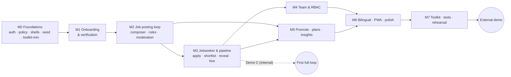

# Servaddis Demo — Implementation Plan

| | |
|---|---|
| **Document** | 06 of 6 — Demo Specification Pack |
| **Version** | 0.1 (draft for review) · 29 Oct 2026 |
| **Depends on** | 01 PRD (scope, priorities) · 02 TRD (stack, budgets) · 03 App Flow (screens, script) · 04 UX/UI Brief · 05 Backend Schema |
| **Build approach** | Vertical slices; every milestone leaves a **demoable** build; P0 first, P1 if on track, P2 last |

---

## 1. Summary and a candid estimate

**What gets built:** one Next.js application with SQLite, simulated integrations behind adapters, bilingual (EN/AM) employer, jobseeker and admin experiences, and a presenter toolkit — as specified in docs 01–05.

**Estimate (focused engineering hours, one full-stack developer):**

| Scope | Hours | Working days @ 7 h | Calendar weeks @ 35 h |
|---|--:|--:|--:|
| **P0 only** — the demo script runs end to end | **152** | ≈ 22 | ≈ 4.3 wk |
| P0 + P1 — adds plans/checkout, insights, expiry/repost, PWA, polish | **181** | ≈ 26 | ≈ 5.2 wk |
| Everything incl. P2 stretch | **185** | ≈ 26 | ≈ 5.3 wk |

> **Flag:** this is larger than "light-weight" may suggest. The *backend* is light (one process, one DB file, no queues). The *surface area* is not: three role-based experiences, two languages, RBAC, moderation, a pipeline, and a presenter toolkit. The estimates assume hand-coding with ordinary tooling and an experienced developer; they do **not** assume AI-assisted speed-ups or a second developer. If your date is fixed, use the **scope levers in §3** rather than compressing quality (rehearsal, bilingual QA and tests are the first things teams squeeze, and they are what protects a live demo).

## 2. Milestones

| Milestone | Hours | Cumulative | P0 hrs | P0 cumulative | Demoable outcome |
|---|--:|--:|--:|--:|---|
| M0 Foundations | 31 | 31 | 31 | 31 | Sign in as any persona; reset works; shells in two languages |
| M1 Onboarding & verification | 22 | 53 | 22 | 53 | **Demo A:** register a venue, upload license, admin verifies, notification arrives |
| M2 Job posting loop | 32 | 85 | 29 | 82 | **Demo B:** post a bilingual job from a template, scam rule blocks a fee request, admin publishes |
| M3 Jobseeker & applicant pipeline | 26 | 111 | 24 | 106 | **Demo C — first credible full loop:** jobseeker applies; employer shortlists, reveals contact, hires |
| M4 Team & permissions (RBAC) | 8 | 119 | 8 | 114 | Staff roles: Poster vs Screener behave differently (UI + API) |
| M5 Promote, plans & insights | 25 | 144 | 10 | 124 | One-click promote with card render; plans/checkout; insights |
| M6 Bilingual, PWA & polish | 17 | 161 | 6 | 130 | Everything in Amharic and English; installable; polished |
| M7 Toolkit, tests & rehearsal | 24 | 185 | 22 | 152 | Rehearsed, tested, fallback ready |

**Rule of thumb for the first external showing:** wait for **Demo C** (end of M3) *plus* M4 (RBAC) and M5's Promote — that is the P0 set the PRD calls credible. Anything before Demo C is for internal feedback only.

### 2.1 Indicative calendar (35 productive hours per week, all priorities in sequence)

| Week | Milestones in progress | You can show |
|---|---|---|
| 1 | M0, start of M1 | Sign-in, shells, personas, reset |
| 2 | M1 finish, start of M2 | Demo A (onboarding → verification) |
| 3 | M2 finish, start of M3 | Demo B (post → moderate → publish) |
| 4 | M3 finish, M4, start of M5 | **Demo C — full hiring loop + RBAC** |
| 5 | M5, M6 | Promote, plans, insights, Amharic, polish |
| 6 (part) | M7 | Tests, rehearsals, fallback video |

If you build **P0 only**, Demo C lands around the end of week 3 and the whole P0 set is complete in about 4.3 weeks. The first full-loop build is the one to put in front of a trusted friendly employer for feedback.

## 3. Cut line and scope levers

### 3.1 Cut order if time runs short

1. **P2** — real Telegram publish, presenter mode.
2. **P1** — plans/checkout (T5.4), insights (T5.5), repost/expiry (T2.6), PWA (T6.2), polish (T6.3), profile (T3.6), audit view (T7.5). *Plans and insights are strong selling points — drop them last among P1.*
3. **Scope levers** below (each has a cost to the story):

| Lever | Hours saved | What you lose |
|---|--:|---|
| Replace admin screens with toolkit **Approve** buttons | ≈ 8 | The moderation story becomes a claim, not a demonstration |
| Replace jobseeker UI with **Simulate applicant** only (keep a read-only job page) | ≈ 8 | "One-tap apply" and the phone moment — a major wow |
| Team screen: presets only, no per-permission toggles | ≈ 2 | The "customise one permission" beat |
| Pipeline: list view only (no board) | ≈ 2 | Visual pipeline metaphor |
| Amharic on the five hero screens only (landing, sign-in, composer, preview, feed) | ≈ 3 | Full bilingual claim; present as "launch languages" with caution |
| Local run only; skip hosted staging | ≈ 2 | Remote sharing and a link for follow-ups |
| **All levers together** | **≈ 25** | P0 total becomes ≈ 127 h |

### 3.2 Things I would *not* cut
Server-side RBAC and its tests, the verification gate, the rules engine, the demo clock/reset, the e2e demo-script test, and the three rehearsals. These make the difference between a demo that *looks* real and one that *survives* being poked.

## 4. Work breakdown

Priorities: **P0** must · **P1** should · **P2** stretch. Hours are focused engineering hours including self-testing.

| ID | Task | Depends on | Pri | Hours | Done when |
|---|---|---|:-:|--:|---|
| **M0** | **Foundations** | | | **31** | |
| T0.1 | Repo, Next.js + TS strict, Tailwind tokens (doc 04 §2.2), shadcn/ui, ESLint/Prettier, CI skeleton | — | P0 | 3 | `pnpm dev` runs; CI green on empty tests |
| T0.2 | Prisma schema from doc 05 §4, SQLite WAL, first migration, db client | T0.1 | P0 | 2 | `prisma validate` passes; tables exist |
| T0.3 | Seed v1: geography, skills, 12 role templates (EN + draft AM), plans, personas, 3 venues, ~40 jobseekers | T0.2 | P0 | 4 | `pnpm seed` idempotent; matches doc 05 §9 |
| T0.4 | OTP + session auth, `/api/me`, role routing, middleware, rate limiting | T0.2 | P0 | 5 | Demo OTP works; lockout after 5; cookie flags correct |
| T0.5 | Policy layer: permission keys, presets, `authorize*`, `withAuth` + unit-test matrix | T0.4 | P0 | 4 | Matrix in doc 03 §6.1 fully covered by tests |
| T0.6 | App shells (employer, jobseeker, admin), `LangToggle`, next-intl scaffold, fonts (Inter + Noto Sans Ethiopic) | T0.1 | P0 | 5 | Shells render at 360/768/1280; language toggles and persists |
| T0.7 | Clock module + sweep + `DemoSetting`; error envelope; zod helpers | T0.2 | P0 | 2 | `now()` honours offset; sweep unit-tested |
| T0.8 | Dockerfile, `pnpm demo` (build + seed + start), hosted staging deploy | T0.3 | P0 | 3 | Local run works offline; staging URL live |
| T0.9 | Minimal toolkit: persona switcher + Reset (needed for all later dev) | T0.3, T0.4 | P0 | 3 | Reset ≤ 10 s; persona switch lands on correct screen |
| **M1** | **Onboarding & verification** | | | **22** | |
| T1.1 | Landing + sign-in screens (phone, OTP, lockout, resend), EN/AM | T0.4, T0.6 | P0 | 4 | SCR-00/01 complete with all states |
| T1.2 | Venue setup screen + venue API (create, patch) | T1.1 | P0 | 3 | SCR-E01; venue + OWNER membership created |
| T1.3 | License upload: dropzone, validation (type/size/magic bytes), storage adapter, authorized file endpoint | T1.2 | P0 | 4 | SCR-E02; invalid files rejected server-side |
| T1.4 | Moderation service + admin queue and review screens (license decisions), audit entries | T1.3, T0.5 | P0 | 6 | SCR-A01/A02 for licenses; venue becomes VERIFIED/REJECTED |
| T1.5 | Employer dashboard, onboarding checklist, notification bell, simulated SMS log | T1.4 | P0 | 5 | SCR-E03; badge updates ≤ 5 s after approval |
| **M2** | **Job posting loop** | | | **32** | |
| T2.1 | Template picker + 12 templates' default content | T0.3, T1.5 | P0 | 4 | SCR-E05; each template fills EN+AM |
| T2.2 | Composer: 4 steps, `BilingualField`, `SalaryRange`, `UrgencySelect`, live preview, draft save | T2.1 | P0 | 10 | SCR-E06; all E-07/E-08 acceptance criteria |
| T2.3 | Rules engine (JSON rules), `/check`, `RuleFlagList`, unit tests incl. Amharic patterns | T2.2 | P0 | 5 | Fee-request blocked; off-platform contact warns |
| T2.4 | Submit flow, entitlement resolver, status chips, jobs list + job overview | T2.3 | P0 | 6 | Unverified venue locked; founding quota decrements on approval |
| T2.5 | Admin job review (flags, fast-approve tag, decisions), publish + expiry calculation | T2.4, T1.4 | P0 | 4 | Approve → LIVE with correct `expiresAt` (EAT rules) |
| T2.6 | Expiry banner (T-3 d), one-tap repost, manual close | T2.5 | P1 | 3 | E-11; repost marked fast-approve if unchanged |
| **M3** | **Jobseeker & applicant pipeline** | | | **26** | |
| T3.1 | Public feed API, feed UI with filters (bottom sheet), job detail | T2.5 | P0 | 6 | SCR-J01/J02 within perf budget |
| T3.2 | Apply (idempotent), tracker (`StepTracker`), jobseeker notifications | T3.1 | P0 | 4 | SCR-J03; duplicate taps safe |
| T3.3 | Applicant list API + pipeline (list/board), verified-first sort, polling, live toast | T3.2 | P0 | 6 | SCR-E08; toast ≤ 5 s |
| T3.4 | Applicant drawer: view/shortlist/reject/hire/reveal; events; audit; masked phone | T3.3 | P0 | 6 | SCR-E09; reveal gating and audit verified |
| T3.5 | Hire → job close at headcount, time-to-fill, schedule check-ins | T3.4 | P0 | 2 | Job auto-closes; `filledAt` set |
| T3.6 | Jobseeker profile screen + completeness meter | T3.2 | P1 | 2 | SCR-J04 |
| **M4** | **Team & permissions (RBAC)** | | | **8** | |
| T4.1 | Team API: invite, change role/grants, remove, last-owner guards | T0.5 | P0 | 3 | Guards enforced server-side |
| T4.2 | Team screen + `PermissionMatrix`; permission-aware UI everywhere; 403 page | T4.1, T3.4 | P0 | 5 | Poster cannot reach applicants; Screener cannot create jobs (UI + API) |
| **M5** | **Promote, plans & insights** | | | **25** | |
| T5.1 | Card renderer (`next/og`) incl. **Amharic font spike**, QR, card endpoint | T2.5 | P0 | 5 | 1080×1080 and 1080×1920 PNGs in EN and AM |
| T5.2 | Promote screen, distribution adapter (sim), captions, channel previews, publish log | T5.1 | P0 | 5 | SCR-E10; TikTok = draft; Simulated tags |
| T5.3 | Optional: real Telegram publish to a demo channel behind `TELEGRAM_REAL` | T5.2 | P2 | 2 | Photo + caption appears in channel |
| T5.4 | Plans, simulated checkout, webhook, subscription, receipt with VAT | T2.4 | P1 | 7 | SCR-E11/E12/E13; Promote unlocks after Pro |
| T5.5 | Insights queries + charts + deterministic seeded history | T3.5, T0.3 | P1 | 6 | SCR-E15; trend shows improvement |
| **M6** | **Bilingual, PWA & polish** | | | **17** | |
| T6.1 | Amharic message pass for all P0 screens/notifications + native-speaker review cycle | T1.1…T5.2 | P0 | 6 | 0 missing keys; no clipped Amharic |
| T6.2 | PWA: manifest, icons, Serwist offline shell, install prompt | T0.6 | P1 | 3 | Installable; offline page shown |
| T6.3 | Visual polish: empty states, skeletons, motion, responsive fixes | T3.4 | P1 | 6 | Design QA checklist (doc 04 §11) |
| T6.4 | Presenter mode (+font scale, spacing) | T6.3 | P2 | 2 | Toggle works on all P0 screens |
| **M7** | **Toolkit, tests & rehearsal** | | | **24** | |
| T7.1 | Toolkit extras: simulate applicant, approve-all, scenario jump, time-skip, phone drawer, Simulated-tag toggle, demo ribbon | T0.9, T3.3 | P0 | 6 | All toolkit functions in doc 02 §5.10 |
| T7.2 | E2E demo-script test (EN + AM) + RBAC API matrix tests | T7.1, T4.2 | P0 | 6 | Script passes on fresh seed in CI |
| T7.3 | Performance + a11y pass: Lighthouse CI budgets, axe, throttled-3G device check | T6.3 | P0 | 4 | Jobseeker routes ≤ 200 KB, FCP ≤ 3.5 s |
| T7.4 | Three rehearsals, runbook, fallback video, bug-fix buffer | T7.2, T7.3 | P0 | 6 | Three consecutive clean runs |
| T7.5 | Admin audit view + counts page | T1.4 | P1 | 2 | SCR-A03 |

**Total: 185 h** (P0 152 · P1 29 · P2 4).

## 5. Build order and dependencies

**Parallelisable work** (if a second person is available, or in gaps): Amharic copy and native review (from M2 onward), logo SVG rebuild and PWA icons, sample license PDF, empty-state illustrations, seed history generator (T5.5 data), e2e script drafting as flows land.

## 6. Environments and repository practice

| Item | Plan |
|---|---|
| Branching | `main` always demoable; short-lived feature branches; squash merges |
| Environments | **local** (primary demo fallback), **staging** (hosted, `DEMO_MODE=1`), optional **showcase** (second hosted copy kept frozen between demos) |
| CI gates | lint → typecheck → unit → build → e2e demo script. A red e2e blocks the showcase deploy |
| Versioning | Tag each rehearsed build `demo-YYYYMMDD-n`; showcase always runs a tagged build |
| Seed versioning | `SEED_VERSION` constant shown in the toolkit; mismatch triggers a "reset needed" warning |
| Secrets | `.env` locally; host secret store for staging; none in repo |
| Documentation | `README` with `pnpm demo`, persona table, demo script, reset instructions; this pack lives in `/docs` |

## 7. Testing and QA plan (maps to TRD §12)

| Gate | Content | Exit criterion |
|---|---|---|
| Per-task | Unit/API tests for the task's rules; manual check in EN and AM at 360 / 1280 px | Task "Done when" met |
| Per-milestone | Walk the relevant part of the demo script from a fresh reset | No manual DB edits needed |
| M5 | Amharic card render spike result recorded; fallback chosen if needed (TRD §15 TR1) | Decision logged |
| M6 | Native-speaker proofreading of all Amharic strings | Review comments resolved |
| M7 | Full e2e (EN + AM); axe; Lighthouse budgets; throttled 3G on a real mid-range Android; projector contrast check | All green |
| Pre-demo | Three consecutive clean rehearsals on the **exact hardware and network** to be used | Checklist in §8 |

**Bug triage during rehearsal:** *Blocker* = breaks the script or shows wrong data → fix now. *Major* = visible glitch on the script path → fix before demo. *Minor* = off-script → backlog.

## 8. Rehearsal, runbook and fallbacks

### 8.1 Pre-demo checklist

**A week before**
- [ ] Tagged build deployed to showcase; three clean rehearsals completed.
- [ ] Amharic strings reviewed by a native speaker.
- [ ] Logo SVG and PWA icons in place; no placeholder text anywhere.
- [ ] Sample license PDF and sample jobseeker devices ready.
- [ ] 3-minute fallback screen recording captured from the tagged build.
- [ ] Decisions on pricing placeholders (PRD Q1) made or the "Illustrative" label confirmed.

**Day before**
- [ ] `pnpm demo` verified on the presenter laptop **offline** (airplane mode).
- [ ] Phone and laptop on a mobile hotspot tested; LAN URL noted for the phone.
- [ ] Fonts render in Amharic on the phone; battery and screen-timeout set.
- [ ] Browser profiles: clean profile, notifications off, zoom 100 %, two windows pre-positioned.

**Hour before**
- [ ] **Reset** from the toolkit; confirm `SEED_VERSION`.
- [ ] Sign in as each persona once to warm caches; return to landing.
- [ ] Close chat and notification apps; set Do Not Disturb.
- [ ] Open fallback video in a tab.

### 8.2 Failure playbook

| Failure | Response |
|---|---|
| Venue Wi-Fi down | Switch to local run on laptop + hotspot (no internet needed) |
| Phone cannot connect | Use the phone-sized browser window and the toolkit's **Simulate applicant** |
| Admin window problem | Toolkit **Approve all pending** |
| Wrong state mid-demo | Toolkit **Scenario jump** to the next step's start state |
| Total failure | Play the fallback video and narrate; offer a follow-up session |
| A partner asks "is this real?" | Show the *Under the hood* panel and the real-vs-simulated table (PRD §8) |

### 8.3 Presenter script
The 17-row script, with timings, is in doc 03 §9. Rehearse it **in Amharic at least once** if any audience member will prefer it.

## 9. Dependencies on you (decisions, assets, people)

| # | Item | Needed by | Owner | Default if late |
|---|---|---|---|---|
| D-1 | Pricing for Standard/Pro/Urgent (PRD Q1) | M5 start | You / client | Illustrative placeholders, clearly labelled |
| D-2 | Unchanged-repost moderation policy (Q2) | M2 | You | Fast-approve queue tag |
| D-3 | Poster visibility of applicant counts (Q3), contact-reveal roles (Q4) | M2 / M3 | You | Defaults in PRD §12 |
| D-4 | Founding-partner quota (Q5) | M2 | You / client | 3 free posts |
| D-5 | Logo vector source (SVG/AI) | M0 | You / designer | Rebuild bell badge in SVG from the PNG |
| D-6 | Native Amharic reviewer (2–3 h) | M6 | You | Ship draft with "review pending" note internally only |
| D-7 | Real photography (optional, permission-cleared) | M6 | You | Initial avatars and illustrations |
| D-8 | Demo hardware list (laptop, phone, hotspot) | M7 | You | Own devices |
| D-9 | Domain/hosting choice for staging | M0 | You | Any VPS/container host with a persistent volume |
| D-10 | Telegram test channel and bot token (only for P2 real publish) | T5.3 | You | Skip — simulated |

## 10. Risks specific to delivery

| # | Risk | Mitigation |
|---|---|---|
| P-1 | Scope grows (gamification, referrals, SMS, jobseeker profile builder) | Hold the PRD §6.3 out-of-scope list; park ideas in a "Post-demo" backlog; revisit after feedback |
| P-2 | Estimates slip on composer/pipeline (largest UI tasks) | Build them first within their milestones; keep the "list-view-only" and "single-page composer" fallbacks |
| P-3 | Amharic review arrives late | Build with keys from day 1; schedule the reviewer for the week of M5; allow two fix cycles |
| P-4 | Late discovery of the Satori/Amharic card issue | Do the spike at the **start** of M5 (T5.1), not the end |
| P-5 | The demo is mistaken for the product | PRD §8 table, *Simulated* tags, and closing slide |
| P-6 | Time lost on infra | `pnpm demo` + Docker are done in M0, not at the end |
| P-7 | Single-person dependency | Keep README and runbook current; tag builds; store the fallback video with the repo release |

## 11. Definition of done — milestone level

A milestone is done when every P0 task in it meets its "Done when", `main` passes CI, the corresponding part of the demo script runs from a fresh reset in **both languages**, and open defects on the script path are zero.

## 12. After the demo

| Step | Detail |
|---|---|
| Capture feedback | After each session record: what they asked first; where they hesitated; which feature they wanted most; pricing reactions; blockers (trust, price, process). A one-page template is enough |
| Decide the path | Option A: build the production system per the proposal (Laravel + MySQL) using the demo's schema, rules, copy and e2e script as acceptance tests. Option B: keep Next.js as the web tier and add Laravel for payments/SMS/admin. See TRD §17 |
| Quick wins to schedule next | Referral engine and gamification (PRD Appendix B), real SMS short-code subscription, Telegram bot, kiosk/assisted onboarding |
| Commercial hygiene | Fix the proposal inconsistencies listed in PRD §13 (payment schedule vs VAT, missing fee figure in the summary, placement-fee conflict) before sending any version to the client |

## Appendix — Quick reference

| Topic | Where |
|---|---|
| Demo logins and OTP | PRD §5 · doc 03 §1.3 · doc 05 §9.4 (OTP `123456`) |
| Permission keys and presets | doc 05 §5 |
| Prisma schema | doc 05 §4 |
| API list | doc 02 §7 |
| Screen IDs and routes | doc 03 §1.2 |
| Colour tokens and contrast audit | doc 04 §2.2 |
| Performance budgets | doc 02 §8 |
